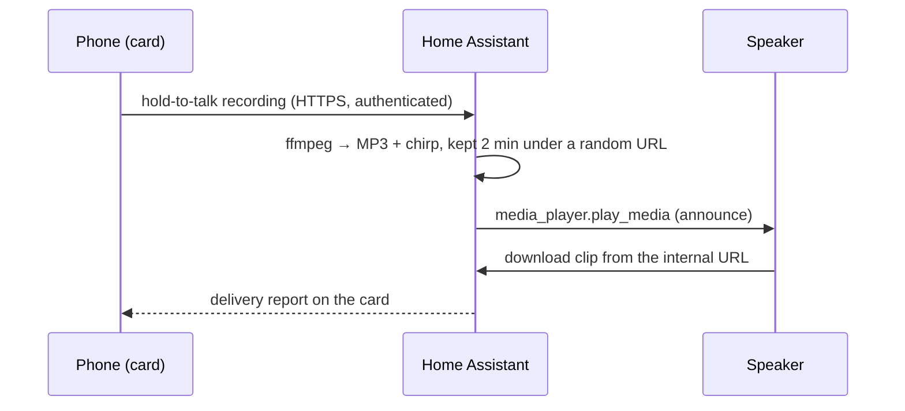

<p align="center">
  
</p>

<h1 align="center">RoomCall</h1>

<p align="center">
  <b>Push-to-talk intercom for Home Assistant, on the speakers you already own.</b><br>
  Hold a button, talk, and your voice plays in the room you picked — Sonos, AirPlay and Google Cast.
</p>

<p align="center">
  <a href="https://my.home-assistant.io/redirect/hacs_repository/?owner=daredoole&repository=RoomCall&category=integration"></a>
</p>

<p align="center">
  <a href="https://hacs.xyz"></a>
  <a href="https://github.com/daredoole/RoomCall/releases"></a>
  <a href="https://github.com/daredoole/RoomCall/actions/workflows/ci.yml"></a>
  <a href="https://github.com/daredoole/RoomCall/actions/workflows/validate.yml"></a>
  <a href="https://daredoole.github.io/RoomCall/"></a>
  <a href="LICENSE"></a>
  <a href="https://github.com/sponsors/daredoole"></a>
  <a href="https://buymeacoffee.com/daredoole"></a>
</p>

<p align="center">
  
  &nbsp;
  
  &nbsp;
  
</p>

---

## Why RoomCall?

Apple's Intercom only works on HomePods, Google's Broadcast only on Google speakers, and Sonos has
no intercom at all. RoomCall turns **every speaker Home Assistant already controls** into one
intercom, organised by your Home Assistant **areas**.

- 🎙️ **Hold to talk** from the Home Assistant app or any browser — a dashboard card, no extra app.
- 🏠 **Rooms are your areas** — talk to one room or the whole house.
- 📻 **Walkie-talkie chirp** before every message so people know a call is coming.
- 🔉 **Announce mode** — Sonos lowers the music for your message instead of stopping it.
- 🗣️ **Automations too** — `roomcall.broadcast` speaks text (TTS) or plays audio in any area.
- 🔒 **Local only** — audio goes from your phone to Home Assistant to the speaker. No cloud, no account.

## Requirements

| | |
|---|---|
| Home Assistant | 2025.6 or newer |
| Speakers | Any `media_player` that can play an MP3 URL: Sonos, Google Cast / Nest, AirPlay, … |
| Microphone | Open the dashboard over **HTTPS** (Nabu Casa, a reverse proxy, Tailscale) or in the Home Assistant mobile app. Browsers block the mic on plain `http://`. |
| Optional | [Chime TTS](https://github.com/nimroddolev/chime_tts) — typed messages then get the chirp too |

## Install

### 1. Download with HACS (recommended)

Click the button, then **Download**, then restart Home Assistant:

[](https://my.home-assistant.io/redirect/hacs_repository/?owner=daredoole&repository=RoomCall&category=integration)

<details>
<summary>No button? Add it manually</summary>

1. HACS → ⋮ (top right) → **Custom repositories**.
2. Repository `https://github.com/daredoole/RoomCall`, type **Integration** → **Add**.
3. Search for **RoomCall** → **Download** → restart Home Assistant.

</details>

<details>
<summary>Without HACS</summary>

Download `roomcall.zip` from the [latest release](https://github.com/daredoole/RoomCall/releases/latest),
unzip it into `/config/custom_components/roomcall/` and restart Home Assistant.

</details>

### 2. Add the integration

[](https://my.home-assistant.io/redirect/config_flow_start/?domain=roomcall)

Pick your speakers — RoomCall pre-selects the ones that support announcements. Choose **one entity
per physical speaker** so messages don't play twice.

### 3. Add the card

Edit a dashboard → **Add card** → search **RoomCall**, or paste:

```yaml
type: custom:roomcall-card
title: Intercom
```

That's it — no resources to register, the integration loads the card for you.

<p align="center">
  
</p>

## Use it in automations

```yaml
action: roomcall.broadcast
data:
  areas: [kitchen, basement]   # leave out for every RoomCall speaker
  message: Dinner is ready!
  volume: 0.4                  # optional
```

Play an audio file instead of text with `media_url:`. The action returns which speakers played
the message, and `sensor.roomcall_last_call` records every call. More examples in the
[Home Assistant guide](https://daredoole.github.io/RoomCall/home-assistant/).

## Options

**Settings → Devices & services → RoomCall → Configure**

| Option | Default | What it does |
|---|---|---|
| Speakers | announce-capable players | Which media players are part of the intercom |
| Announcement volume | speaker's current volume | Fixed volume for calls (Sonos) |
| Play a chime first | on | Walkie-talkie chirp before each message |
| Microphone boost | 0 dB | Raise if phone recordings sound quiet |
| Text-to-speech engine | your default | Used for typed messages |

## How it works



A call plays about 1–2 seconds after you let go (AirPlay adds ~2 s of buffering).

## FAQ

<details>
<summary><b>Can people talk back through the speaker?</b></summary>

Not through Sonos, HomePod or Nest speakers — their microphones are reserved for their own voice
assistants. Talk-back needs a device RoomCall can listen to (a phone or tablet, or a Home Assistant
voice satellite); it's next on the [roadmap](https://daredoole.github.io/RoomCall/roadmap/).
</details>

<details>
<summary><b>The card says "Microphone blocked".</b></summary>

Open Home Assistant over HTTPS (or use the companion app) and allow the microphone when asked.
See [Troubleshooting](https://daredoole.github.io/RoomCall/troubleshooting/).
</details>

<details>
<summary><b>It says "Delivered" but I hear nothing.</b></summary>

The speaker couldn't download the clip. Set **Settings → System → Network → Local network** to an
address your speakers can reach, e.g. `http://192.168.1.10:8123`.
</details>

## Standalone server (no Home Assistant)

RoomCall also runs on its own, discovering speakers over mDNS and serving a web app:

```bash
pipx install "roomcall[all]"
roomcall serve        # http://<this-machine>:8765
```

See [Getting started](https://daredoole.github.io/RoomCall/getting-started/).

## Support the project

RoomCall is free and MIT-licensed. If it's useful in your home, you can sponsor its development:

<a href="https://github.com/sponsors/daredoole"></a>
&nbsp;
<a href="https://buymeacoffee.com/daredoole"></a>

Sponsorship never buys feature priority, private support or early access to security fixes.

## Contributing

Bug reports, speaker compatibility notes and pull requests are welcome — see
[CONTRIBUTING.md](CONTRIBUTING.md) and the [Code of Conduct](CODE_OF_CONDUCT.md).
Security issues: please follow [SECURITY.md](SECURITY.md).

## License

[MIT](LICENSE)
