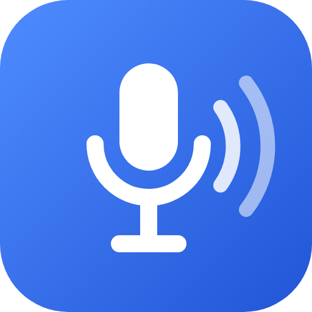
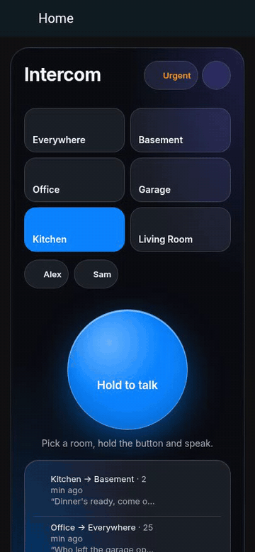
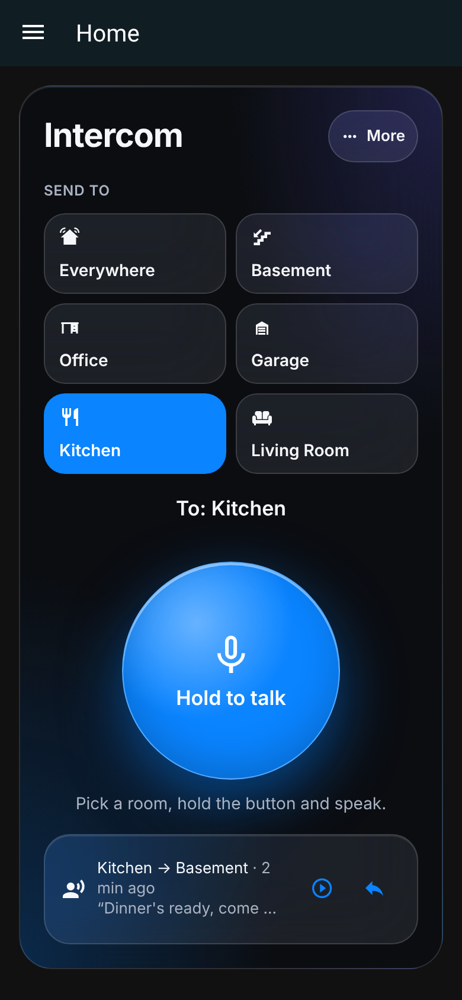
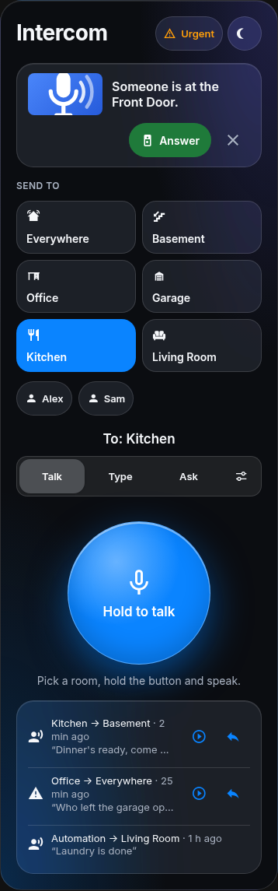
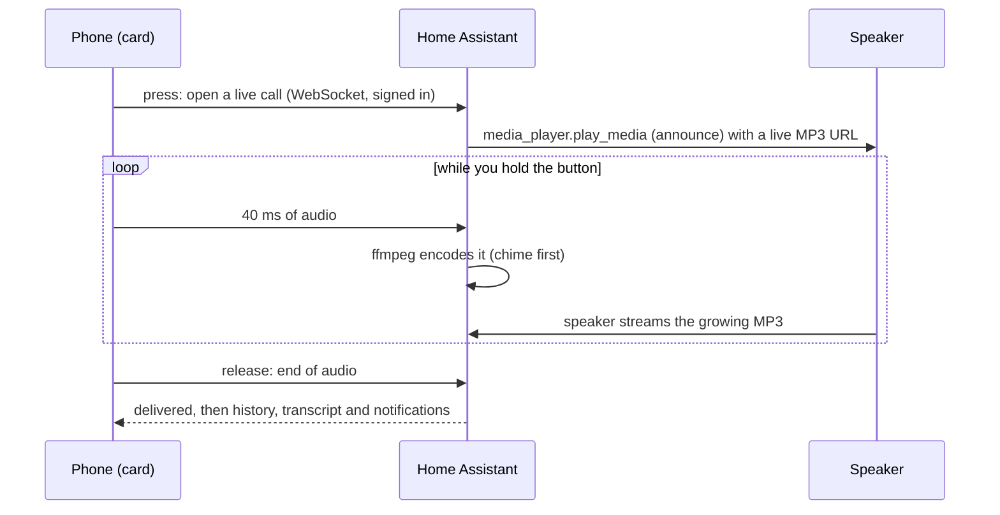

<p align="center">
  
</p>

<h1 align="center">RoomCall</h1>

<p align="center">
  <b>A push-to-talk intercom for Home Assistant, on the speakers you already own.</b><br>
  Hold a button, talk, and your voice plays in the room you picked — on Sonos, Google Cast or AirPlay.
</p>

<p align="center">
  <a href="https://my.home-assistant.io/redirect/hacs_repository/?owner=daredoole&repository=RoomCall&category=integration"></a>
</p>

<p align="center">
  <a href="https://hacs.xyz"></a>
  <a href="https://github.com/daredoole/RoomCall/releases"></a>
  <a href="https://github.com/daredoole/RoomCall/actions/workflows/ci.yml"></a>
  <a href="https://daredoole.github.io/RoomCall/"></a>
  <a href="LICENSE"></a>
</p>

<p align="center">
  
  &nbsp;&nbsp;
  
</p>

<p align="center"><sub>The real card in a test harness with sample rooms; it shows the interface, not a speaker playing
(<a href="docs/screenshots.md">how screenshots are made</a>).</sub></p>

## Get started in three steps

You need Home Assistant 2025.6 or newer with [HACS](https://hacs.xyz/docs/use/), and speakers
that Home Assistant can already play to.

1. **Install.** Click the HACS button above, then **Download**, then restart Home Assistant.
   <details><summary>No button, or no HACS?</summary>

   - HACS → ⋮ → **Custom repositories** → add `https://github.com/daredoole/RoomCall` as
     **Integration** → search **RoomCall** → **Download** → restart.
   - Without HACS: unzip `roomcall.zip` from the
     [latest release](https://github.com/daredoole/RoomCall/releases/latest) into
     `/config/custom_components/roomcall/` and restart.

   </details>
2. **Add the integration** —
   [](https://my.home-assistant.io/redirect/config_flow_start/?domain=roomcall)
   and pick your speakers. RoomCall pre-selects the ones that support announcements; choose
   **one entity per physical speaker** so a call doesn't play twice.
3. **Add the card.** Edit a dashboard → **Add card** → **RoomCall**. Open it in the Home
   Assistant app (or over HTTPS, so the browser allows the microphone), pick a room and hold
   to talk.

Then check each room once: **More → Settings (sliders icon) → Setup and sound tests** plays a
test sound in each room and asks whether you heard it.
[Full setup guide →](https://daredoole.github.io/RoomCall/home-assistant/)

## What you can do with it

### "Dinner's ready!"

Pick **Kitchen**, **Basement** or **Everywhere**, hold the button and say it. Your voice
streams while you talk, after a short chime. Rather type? **Type** reads your message aloud
in your Home Assistant voice. Call **a person** and it plays in the room they're in (with room
presence such as [Bermuda](https://github.com/agittins/bermuda)).

### Answer the door from any room



When the doorbell is pressed, the rooms you pick hear *"Someone is at the Front Door."*
Every RoomCall card, and the phones you've set up for notifications, show the camera snapshot
with an **Answer** button that opens Home Assistant's live camera view. Talking to the
visitor works there when your camera supports two-way audio
([details](https://daredoole.github.io/RoomCall/communication/#answer-the-door)).

<br clear="right">

### Siri to any speaker

Say **"Hey Siri, run RoomCall Basement"**, dictate a message, and it's spoken on the basement
speakers — no HomePod needed. The card builds the shortcut steps for you
([Siri guide](https://daredoole.github.io/RoomCall/siri-shortcuts/)). Or add each room to the
**Apple Home** app as a camera tile and tap its microphone to talk
([Apple Home](https://daredoole.github.io/RoomCall/apple-home/)).

### Reminders that wait until it's done


"The laundry is done" keeps reminding until someone taps **Took out the dry clothes** on their
phone or the card. Swiping the notification away doesn't count. Schedule announcements
("Bus in 10 minutes" on weekdays) or trigger them ("The garage has been open 10 minutes")
([announcements](https://daredoole.github.io/RoomCall/announcements/)).

<br clear="right">

### Talk back

Speaker microphones (Sonos, HomePod, Nest) belong to their own assistants, so replies come
another way: a **Reply** button on the call notification aims the card back at the caller, or a
small Assist satellite in the room listens for a spoken answer
([hands-free talk-back](https://daredoole.github.io/RoomCall/communication/#hands-free-talk-back)).
Two wall tablets can also call each other live as
[room stations](https://daredoole.github.io/RoomCall/communication/#browser-room-stations).

## Also included

- **Quiet when it should be** — Do Not Disturb, quiet hours that skip bedrooms, and **Urgent**
  for when it matters.
- **Your chime** — walkie-talkie, ding, doorbell… or your own sound, before every call.
- **Call history** with replay, and transcripts if you add a speech-to-text engine.
- **Card layouts** — simple (new cards), standard, compact, and kiosk for a wall tablet;
  Glass, Material or your dashboard's own theme.
- **Receivers and TV boxes** — Denon/HEOS receivers and Android/Google TV boxes can be woken
  for the call and put back afterwards, where the device allows it
  ([limits](docs/communication.md#playback-device-routes)).
- **Automations** — `roomcall.broadcast`, a notify entity per room and ready-made blueprints.
- **Repairs** — Home Assistant warns about addresses speakers usually can't use (for example
  `localhost` or a `.local` name) and offers to switch to your network address after you confirm.
- **iPhone app** — a sideloadable app with hold-to-talk, messages, tasks and history
  ([native iOS app](https://daredoole.github.io/RoomCall/native-ios/)).
- **Local audio** — calls go from your phone to Home Assistant to the speaker. Speech and
  translation use only the providers you choose.
- 🌍 English, Español, Deutsch, Français, Nederlands.

## Works with

| | |
|---|---|
| Home Assistant | 2025.6 or newer (tested on 2026.2 and 2026.10) |
| Speakers | Any `media_player` that can play an MP3 URL: Sonos, Google Cast / Nest, AirPlay, … — and [Music Assistant](https://daredoole.github.io/RoomCall/home-assistant/#music-assistant-speakers) players |
| Microphone | The Home Assistant app, or a browser on **HTTPS** (Nabu Casa, a reverse proxy, Tailscale). Browsers block the mic on plain `http://`. |
| Optional | Speech-to-text (transcripts), room presence such as Bermuda (call a person), an Assist satellite (spoken replies) |

The iPhone app's sign-in needs Home Assistant 2026.10 or later.

## Automations and blueprints

```yaml
action: roomcall.broadcast
data:
  areas: [kitchen, basement]   # leave out for every RoomCall speaker
  message: Dinner is ready!
  priority: urgent             # optional: louder, ignores Do Not Disturb and quiet hours
```

`people: [person.alex]` plays wherever Alex is; `media_url:` plays a sound file instead of
text. More in the [Home Assistant guide](https://daredoole.github.io/RoomCall/home-assistant/#roomcallbroadcast-action).

| Blueprint | What it does | |
|---|---|---|
| **Announce the doorbell** | Doorbell press → "Someone is at the front door" in the rooms you pick (optional urgent). | [](https://my.home-assistant.io/redirect/blueprint_import/?blueprint_url=https%3A%2F%2Fgithub.com%2Fdaredoole%2FRoomCall%2Fblob%2Fmain%2Fblueprints%2Fautomation%2Froomcall%2Fdoorbell.yaml) |
| **Appliance finished** | Washer/dryer/dishwasher power drops after running → "The laundry is done." | [](https://my.home-assistant.io/redirect/blueprint_import/?blueprint_url=https%3A%2F%2Fgithub.com%2Fdaredoole%2FRoomCall%2Fblob%2Fmain%2Fblueprints%2Fautomation%2Froomcall%2Fappliance_done.yaml) |
| **Do Not Disturb at bedtime** | Turns RoomCall's Do Not Disturb on at night and off in the morning. | [](https://my.home-assistant.io/redirect/blueprint_import/?blueprint_url=https%3A%2F%2Fgithub.com%2Fdaredoole%2FRoomCall%2Fblob%2Fmain%2Fblueprints%2Fautomation%2Froomcall%2Fbedtime_dnd.yaml) |
| **Announce arrivals** | "Alex is home." when someone arrives. | [](https://my.home-assistant.io/redirect/blueprint_import/?blueprint_url=https%3A%2F%2Fgithub.com%2Fdaredoole%2FRoomCall%2Fblob%2Fmain%2Fblueprints%2Fautomation%2Froomcall%2Farrival.yaml) |

## For power users and developers

- **What "delivered" means** — RoomCall reports that each speaker *accepted* the request, plus
  any evidence the device sends back. It never claims someone heard it; ask for an explicit
  acknowledgment when that matters ([messages and delivery](https://daredoole.github.io/RoomCall/communication/)).
- **AI and Assist** — Assist and MCP agents get RoomCall tools to send messages, manage
  announcements and run guided setup, within Home Assistant's permissions
  ([AI guide](https://daredoole.github.io/RoomCall/ai/), [`llms.txt`](https://daredoole.github.io/RoomCall/llms.txt)).
- **All options** — speakers, volumes, chimes, delivery timing, quiet hours, notifications and
  more are under *Settings → Devices & services → RoomCall → Configure*
  ([every option](https://daredoole.github.io/RoomCall/home-assistant/#2-add-the-integration)).

## How it works



With **live calls** (the default), audio streams while you hold the button; each
speaker's startup, buffering and playback queue determine when you hear it.
With `live: false`, the card records the whole message before sending. No fixed
latency is guaranteed for either route, especially for Everywhere or repeated calls.

## FAQ

<details>
<summary><b>Can people talk back through the speaker?</b></summary>

A converted **TECHO5 Echo** supports live two-way microphone and speaker audio with
the RoomCall dashboard on a phone or tablet. Pair it under **Settings → Room stations**;
incoming calls require its Action button. The local voice command “RoomCall Kitchen”
invites an open Kitchen browser station, where someone must press Answer.
See [Echo live calls](https://daredoole.github.io/RoomCall/communication/#converted-echo-live-calls).

Not through Sonos, HomePod or Nest speakers — their microphones are reserved for their own voice
assistants. Put a small Assist satellite (Atom Echo, ESP32-S3, Home Assistant Voice) in the room
and turn on **Hands-free talk-back**: after a call, it listens for a reply and the caller's room
hears it. Replies are transcribed and spoken back in your configured voice
([how](https://daredoole.github.io/RoomCall/communication/#hands-free-talk-back)). People can also
reply from their phone: the call notification has a **Reply** button aimed back at the caller.
</details>

<details>
<summary><b>The card says "Microphone blocked".</b></summary>

Open Home Assistant over HTTPS (or use the companion app) and allow the microphone when asked.
See [Troubleshooting](https://daredoole.github.io/RoomCall/troubleshooting/).
</details>

<details>
<summary><b>It says the call was accepted, but I hear nothing.</b></summary>

Accepted is not the same as heard. Check the room, volume and anything already playing. The
most common cause is a Home Assistant address the speakers can't reach: look in
**Settings → System → Repairs**, and make sure **Settings → System → Network → Local network**
is an address like `http://192.168.1.10:8123`. See [troubleshooting](docs/troubleshooting.md).
</details>

## Standalone server (no Home Assistant)

RoomCall also runs on its own, discovering speakers over mDNS and serving a web app:

```bash
pipx install "roomcall[all] @ https://github.com/daredoole/RoomCall/releases/download/v0.22.1/roomcall-0.22.1-py3-none-any.whl"
roomcall serve        # http://<this-machine>:8765
```

The standalone package is distributed in GitHub releases; it is not currently published on PyPI.

See [Getting started](https://daredoole.github.io/RoomCall/getting-started/).

## Support the project

RoomCall is free and MIT-licensed. If it's useful in your home, you can sponsor its development:

<a href="https://github.com/sponsors/daredoole"></a>
&nbsp;
<a href="https://buymeacoffee.com/daredoole"></a>

Sponsorship never buys feature priority, private support or early access to security fixes.

## Contributing

Bug reports, speaker compatibility notes and pull requests are welcome — see
[CONTRIBUTING.md](CONTRIBUTING.md) and the [Code of Conduct](CODE_OF_CONDUCT.md).
Security issues: please follow [SECURITY.md](SECURITY.md).

## License

[MIT](LICENSE)
