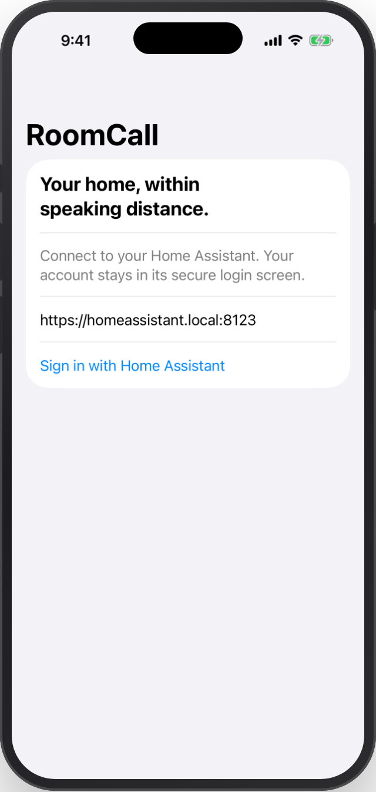
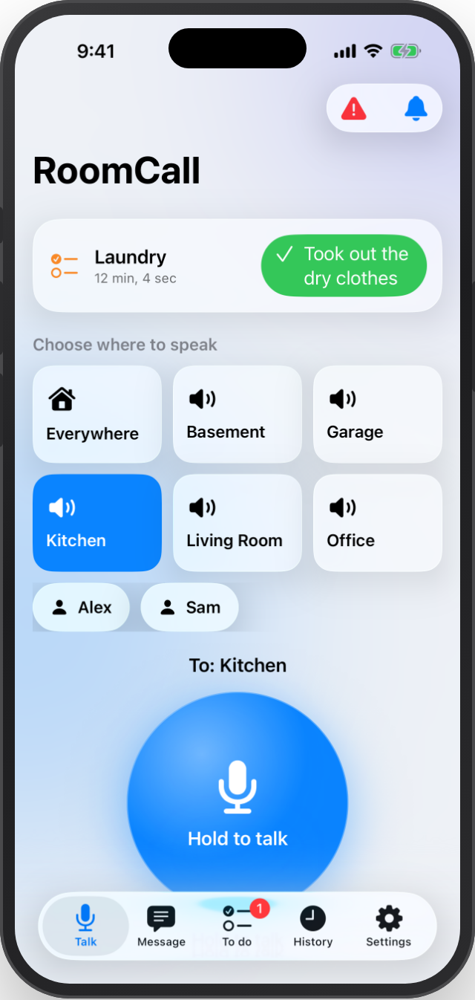
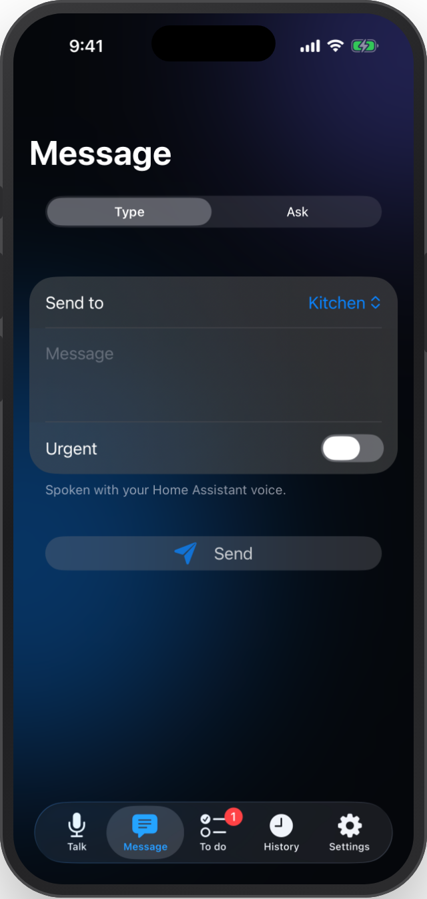
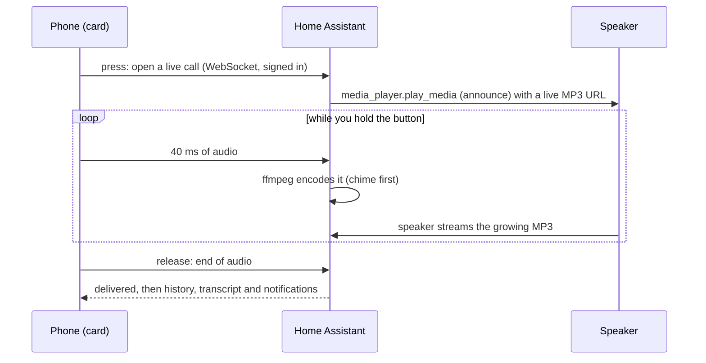

<p align="center">
  
</p>

<h1 align="center">RoomCall</h1>

<p align="center">
  <b>Push-to-talk intercom for Home Assistant, on the speakers you already own.</b><br>
  Hold a button, talk, and your voice plays in the room you picked — Sonos, AirPlay and Google Cast.
</p>

<p align="center">
  <a href="https://my.home-assistant.io/redirect/hacs_repository/?owner=daredoole&repository=RoomCall&category=integration"></a>
</p>

<p align="center">
  <a href="https://hacs.xyz"></a>
  <a href="https://github.com/daredoole/RoomCall/releases"></a>
  <a href="https://github.com/daredoole/RoomCall/actions/workflows/ci.yml"></a>
  <a href="https://github.com/daredoole/RoomCall/actions/workflows/validate.yml"></a>
  <a href="https://daredoole.github.io/RoomCall/"></a>
  <a href="https://scorecard.dev/viewer/?uri=github.com/daredoole/RoomCall"></a>
  <a href="LICENSE"></a>
  <a href="https://github.com/sponsors/daredoole"></a>
  <a href="https://buymeacoffee.com/daredoole"></a>
</p>

<p align="center">
  
</p>

<p align="center">
  
  &nbsp;
  
  &nbsp;
  
</p>

---

The browser captures use the real card in a test harness with sample rooms and
simulated delivery. Native captures use iOS Simulator demo mode. They illustrate
the interface, not physical-speaker results; see the [capture record](docs/screenshots.md).

## Why RoomCall?

Apple's Intercom only works on HomePods, Google's Broadcast only on Google speakers, and Sonos has
no intercom at all. RoomCall turns **compatible speakers Home Assistant already controls** into one
intercom, organised by your Home Assistant **areas**, and adds the things a family actually needs:
replies, quiet nights, reminders that don't go away until the chore is done, and Siri.

### 🎙️ Talk to any room

- **Hold to talk, live** — stream while you talk from the Home Assistant app or a compatible browser; speaker startup and queues determine when playback begins.
- **Rooms are your areas** — one room, the whole house, or **a person** wherever they are right now.
- **Talk, Type or Ask** — speak, type a message for text-to-speech, or ask a question and collect a real answer from an Assist satellite. Preview intended speaker destinations before sending.
- **Reply** — hands-free from the called room through a small Assist satellite, or from your phone's notification, aimed back at the caller.
- **Urgent, Do Not Disturb and quiet hours** — quieter nights, skipped bedrooms, and an override when it matters.
- **Call history** with replay and speech-to-text transcripts.
- **Household profiles** — saved destinations, message defaults and voice/chime settings in the Type tab.
- **Prepared speech** — explicit fast/balanced/quality voice choices and bounded, private in-memory reuse for repeated messages. These names are configuration labels, not speed guarantees.
- **Your chime** — walkie-talkie, ding, doorbell… or your own file, before talk, typed messages, Siri and announcements alike.
- **Answer the door** — the doorbell rings your rooms, and phones, watches and every card get the camera snapshot with an **Answer** button that opens the live view.
- **Browser room stations** — call another open dashboard over WebRTC; the other side answers before any audio connects.

### ✅ Announcements and tasks

<p align="center">
  
</p>

- **Scheduled and triggered announcements** — "Bus in 10 minutes" on weekdays, "{{ name }} is on" when the porch light switches, "the garage has been open 10 minutes" — to rooms, speakers or people.
- **Tasks you have to confirm** — give an announcement a task like *Took out the dry clothes*. It keeps reminding until someone taps that button on their phone, on the card's **To do** list or on a **Mark done** button. Swiping the notification away doesn't count; **Remind me later** snoozes it. Who did it, and when, is recorded, and automations get a `roomcall_task_completed` event ([how it works](https://daredoole.github.io/RoomCall/announcements/#tasks-confirm-it-was-actually-done)).
- **Acknowledgments and delivery evidence** — ask for an explicit "got it", and see what each speaker actually reported instead of a blind "sent".
- **Durable message jobs** — opt into preserving queued text messages over restarts; uncertain dispatched work is interrupted rather than automatically replayed.
- **Delivery timeline** — see preparation and dispatch stages, separate from device evidence and human acknowledgment.
- **Optional voicemail and translation** — bounded local retention, per-person languages and explicit translation providers.

### ⚙️ One settings panel on the card

<p align="center">
  
  &nbsp;
  
  &nbsp;
  
  &nbsp;
  
</p>

Tap the sliders icon on the card for **Settings**:

- **Setup and sound tests** — scan your speakers, pick a voice and volume, review a saved setup plan, apply it, play a test sound on each speaker and confirm you heard it. Resume anytime, diagnose problems, or undo.
- **Siri Shortcuts** — build a shortcut for one room or a **live room picker** that asks where to announce each time, as a native Home Assistant *Perform Action* template or a portable link ([guide](https://daredoole.github.io/RoomCall/siri-shortcuts/)).
- **Room stations** — turn the dashboard you're on into a station other rooms can call.
- **Voicemail** — when enabled, list, replay or delete retained messages.

Browser QA exercises keyboard controls and layouts from a 240 px column to a wall tablet.

### 📱 Your phone and Apple devices

<p align="center">
  
  &nbsp;
  
  &nbsp;
  
</p>
<p align="center"><sub>Native iOS app, captured from the iOS Simulator in CI.</sub></p>

- **"Hey Siri, run RoomCall Basement"** — dictate an announcement to any room, with your chime and Home Assistant voice; no HomePod required.
- **Apple Home intercom** — every room is a camera tile in the Home app; tap the mic on your iPhone or Apple Watch to talk in that room.
- **Notifications that do something** — Reply, Acknowledge, and task buttons right on the notification.
- **Native iOS app** — sideloadable SwiftUI app with HA sign-in, in-app hold to talk, typed messages, questions, tasks, history, foreground doorbell alerts, Siri, widgets and Live Activities. CI supplies an unsigned IPA that needs your signing ([build and limitations](https://daredoole.github.io/RoomCall/native-ios/)).

### 🏠 Smart home and AI

- **Automations** — `roomcall.broadcast`, a **notify entity per room** (`notify.roomcall_kitchen`), and ready-made **blueprints** for the doorbell, laundry, bedtime and arrivals.
- **AV receivers and TV boxes** — Denon/HEOS and onn/Google TV play the call, then go back to the TV input, volume and app they were on. Sonos lowers the music instead of stopping it.
- **AI-ready** — Assist and MCP agents get explicit RoomCall tools: discover, preview, send, check status, manage announcements and tasks, and run guided setup with reviewable plans and undo ([AI guide](https://daredoole.github.io/RoomCall/ai/), [agent setup](https://daredoole.github.io/RoomCall/agent-setup/), [`llms.txt`](https://daredoole.github.io/RoomCall/llms.txt)). Agents respect Home Assistant permissions and exposure. Dedicated accounts can also have RoomCall operation/destination/hour/volume/rate limits and owned-job subscriptions. These limits do not scope unrelated HA services.
- **Diagnostics and Repairs** — problems show up in Home Assistant, not as silent calls.
- 🌍 English, Español, Deutsch, Français, Nederlands.
- 🔒 **Local audio delivery** — recordings go from your phone to Home Assistant to the speaker. Optional speech and translation processing follows only the providers you configure.

<p align="center">
  
  &nbsp;
  
  &nbsp;
  
</p>

## Requirements

| | |
|---|---|
| Home Assistant | 2025.6 or newer |
| Speakers | Any `media_player` that can play an MP3 URL: Sonos, Google Cast / Nest, AirPlay, … |
| Microphone | Open the dashboard over **HTTPS** (Nabu Casa, a reverse proxy, Tailscale) or in the Home Assistant mobile app. Browsers block the mic on plain `http://`. |
| Optional | A speech-to-text engine (transcripts), room presence such as [Bermuda](https://github.com/agittins/bermuda) (call a person) |

The declared HA minimum is 2025.6; CI tests HA 2026.2.3 and 2026.10.2.
The native app's PKCE sign-in requires HA 2026.10 or later.

## Install

### 1. Download with HACS (recommended)

Click the button, then **Download**, then restart Home Assistant:

[](https://my.home-assistant.io/redirect/hacs_repository/?owner=daredoole&repository=RoomCall&category=integration)

<details>
<summary>No button? Add it manually</summary>

1. HACS → ⋮ (top right) → **Custom repositories**.
2. Repository `https://github.com/daredoole/RoomCall`, type **Integration** → **Add**.
3. Search for **RoomCall** → **Download** → restart Home Assistant.

</details>

<details>
<summary>Without HACS</summary>

Download `roomcall.zip` from the [latest release](https://github.com/daredoole/RoomCall/releases/latest),
unzip it into `/config/custom_components/roomcall/` and restart Home Assistant.

</details>

### 2. Add the integration

[](https://my.home-assistant.io/redirect/config_flow_start/?domain=roomcall)

Pick your speakers — RoomCall pre-selects the ones that support announcements. Choose **one entity
per physical speaker** so messages don't play twice.

### 3. Add the card

Edit a dashboard → **Add card** → search **RoomCall**, or paste:

```yaml
type: custom:roomcall-card
title: Intercom
```

That's it — no resources to register, the integration loads the card for you.

Then open **Settings → Setup and sound tests** on the card and play a test sound on each speaker.
See [Messages and room stations](https://daredoole.github.io/RoomCall/communication/)
for message jobs, acknowledgments, browser calls, permissions and adapter setup.

<p align="center">
  
</p>

## Use it in automations

```yaml
action: roomcall.broadcast
data:
  areas: [kitchen, basement]   # leave out for every RoomCall speaker
  message: Dinner is ready!
  volume: 0.4                  # optional
```

```yaml
action: roomcall.broadcast
data:
  people: [person.alex]        # wherever Alex is right now
  message: Your ride is here
  priority: urgent             # ignores Do Not Disturb and quiet hours
```

Play an audio file instead of text with `media_url:`. The action returns per-speaker
request results, not proof of audible playback. `sensor.roomcall_last_call` summarizes
recent calls. More examples in the
[Home Assistant guide](https://daredoole.github.io/RoomCall/home-assistant/), and
"Hey Siri, run RoomCall Basement" in [Siri and Shortcuts](https://daredoole.github.io/RoomCall/siri-shortcuts/).

React when someone confirms a task:

```yaml
triggers:
  - trigger: event
    event_type: roomcall_task_completed
    event_data:
      name: Laundry
actions:
  - action: light.turn_off
    target:
      entity_id: light.laundry_room
```

## Blueprints

| Blueprint | What it does | |
|---|---|---|
| **Announce the doorbell** | Doorbell press → "Someone is at the front door" in the rooms you pick (optional urgent). | [](https://my.home-assistant.io/redirect/blueprint_import/?blueprint_url=https%3A%2F%2Fgithub.com%2Fdaredoole%2FRoomCall%2Fblob%2Fmain%2Fblueprints%2Fautomation%2Froomcall%2Fdoorbell.yaml) |
| **Appliance finished** | Washer/dryer/dishwasher power drops after running → "The laundry is done." | [](https://my.home-assistant.io/redirect/blueprint_import/?blueprint_url=https%3A%2F%2Fgithub.com%2Fdaredoole%2FRoomCall%2Fblob%2Fmain%2Fblueprints%2Fautomation%2Froomcall%2Fappliance_done.yaml) |
| **Do Not Disturb at bedtime** | Turns RoomCall's Do Not Disturb on at night and off in the morning. | [](https://my.home-assistant.io/redirect/blueprint_import/?blueprint_url=https%3A%2F%2Fgithub.com%2Fdaredoole%2FRoomCall%2Fblob%2Fmain%2Fblueprints%2Fautomation%2Froomcall%2Fbedtime_dnd.yaml) |
| **Announce arrivals** | "Alex is home." when someone arrives. | [](https://my.home-assistant.io/redirect/blueprint_import/?blueprint_url=https%3A%2F%2Fgithub.com%2Fdaredoole%2FRoomCall%2Fblob%2Fmain%2Fblueprints%2Fautomation%2Froomcall%2Farrival.yaml) |

## Options

**Settings → Devices & services → RoomCall → Configure**

| Option | Default | What it does |
|---|---|---|
| Speakers | announce-capable players | Which media players are part of the intercom |
| Announcement volume | speaker's current volume | Fixed volume for calls (Sonos) |
| Microphone boost | 0 dB | Raise if phone recordings sound quiet |
| Text-to-speech engine | your default | Used for typed messages |
| Chime | walkie-talkie chirp | Chirp, ding, double beep, rising, doorbell, none — or your own file |
| Delivery | 250 ms apart, retry on | Stops Sonos speakers from dropping simultaneous calls |
| Quiet hours | off | Quieter calls and skipped rooms overnight |
| Notifications and replies | off | Phones to notify, Reply button, speech-to-text |
| Communication profiles and agent policies | empty | Saved household/voice profiles and optional per-account RoomCall restrictions |
| Apple Home | off | Rooms as camera tiles with a talk button in the Home app |

**Announcements** are added from the integration's ⋮ menu: *Add scheduled announcement* /
*Add triggered announcement* ([guide](https://daredoole.github.io/RoomCall/announcements/)).
Add a **Task to confirm** and **Remind every** to make one stay open until it's done.
Card options (`room`, `people`, `history`, `layout`, `live`, and the look: `appearance` glass /
material / home-assistant, `theme`, `color`) are set in the visual editor
([details](https://daredoole.github.io/RoomCall/home-assistant/#3-add-the-push-to-talk-card)).

## How it works



With **live calls** (the default), audio streams while you hold the button; each
speaker's startup, buffering and playback queue determine when you hear it.
With `live: false`, the card records the whole message before sending. No fixed
latency is guaranteed for either route, especially for Everywhere or repeated calls.

## FAQ

<details>
<summary><b>Can people talk back through the speaker?</b></summary>

Not through Sonos, HomePod or Nest speakers — their microphones are reserved for their own voice
assistants. Put a small Assist satellite (Atom Echo, ESP32-S3, Home Assistant Voice) in the room
and turn on **Hands-free talk-back**: after a call, it listens for a reply and the caller's room
hears it. Replies are transcribed and spoken back in your configured voice
([how](https://daredoole.github.io/RoomCall/communication/#hands-free-talk-back)). People can also
reply from their phone: the call notification has a **Reply** button aimed back at the caller.
</details>

<details>
<summary><b>The card says "Microphone blocked".</b></summary>

Open Home Assistant over HTTPS (or use the companion app) and allow the microphone when asked.
See [Troubleshooting](https://daredoole.github.io/RoomCall/troubleshooting/).
</details>

<details>
<summary><b>It says "Delivered" but I hear nothing.</b></summary>

Acceptance does not establish audibility. Check the selected destination, volume,
active playback/queue and delivery evidence. A common cause is an unreachable clip
URL: set **Settings → System → Network → Local network** to an address your speakers
can reach, e.g. `http://192.168.1.10:8123`. See [troubleshooting](docs/troubleshooting.md).
</details>

## Standalone server (no Home Assistant)

RoomCall also runs on its own, discovering speakers over mDNS and serving a web app:

```bash
pipx install "roomcall[all] @ https://github.com/daredoole/RoomCall/releases/download/v0.18.2/roomcall-0.18.2-py3-none-any.whl"
roomcall serve        # http://<this-machine>:8765
```

The standalone package is distributed in GitHub releases; it is not currently published on PyPI.

See [Getting started](https://daredoole.github.io/RoomCall/getting-started/).

## Support the project

RoomCall is free and MIT-licensed. If it's useful in your home, you can sponsor its development:

<a href="https://github.com/sponsors/daredoole"></a>
&nbsp;
<a href="https://buymeacoffee.com/daredoole"></a>

Sponsorship never buys feature priority, private support or early access to security fixes.

## Contributing

Bug reports, speaker compatibility notes and pull requests are welcome — see
[CONTRIBUTING.md](CONTRIBUTING.md) and the [Code of Conduct](CODE_OF_CONDUCT.md).
Security issues: please follow [SECURITY.md](SECURITY.md).

## License

[MIT](LICENSE)
