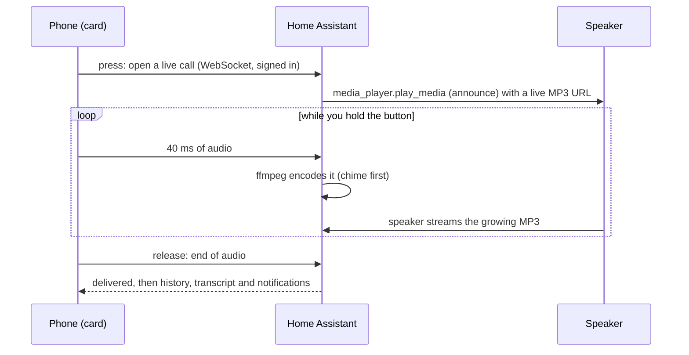

<p align="center">
  
</p>

<h1 align="center">RoomCall</h1>

<p align="center">
  <b>Push-to-talk intercom for Home Assistant, on the speakers you already own.</b><br>
  Hold a button, talk, and your voice plays in the room you picked — Sonos, AirPlay and Google Cast.
</p>

<p align="center">
  <a href="https://my.home-assistant.io/redirect/hacs_repository/?owner=daredoole&repository=RoomCall&category=integration"></a>
</p>

<p align="center">
  <a href="https://hacs.xyz"></a>
  <a href="https://github.com/daredoole/RoomCall/releases"></a>
  <a href="https://github.com/daredoole/RoomCall/actions/workflows/ci.yml"></a>
  <a href="https://github.com/daredoole/RoomCall/actions/workflows/validate.yml"></a>
  <a href="https://daredoole.github.io/RoomCall/"></a>
  <a href="https://scorecard.dev/viewer/?uri=github.com/daredoole/RoomCall"></a>
  <a href="LICENSE"></a>
  <a href="https://github.com/sponsors/daredoole"></a>
  <a href="https://buymeacoffee.com/daredoole"></a>
</p>

<p align="center">
  
</p>

<p align="center">
  
  &nbsp;
  
  &nbsp;
  
</p>

---

## Why RoomCall?

Apple's Intercom only works on HomePods, Google's Broadcast only on Google speakers, and Sonos has
no intercom at all. RoomCall turns **every speaker Home Assistant already controls** into one
intercom, organised by your Home Assistant **areas**.

- 🎙️ **Hold to talk, live** — speakers start playing while you are still talking, from the Home Assistant app or any browser.
- 🏠 **Rooms are your areas** — talk to one room, the whole house, or **a person** wherever they are.
- ↩️ **Reply** — every call can notify your phones with a Reply button aimed back at the caller.
- 🌙 **Do Not Disturb, quiet hours and urgent calls** — quieter nights, skipped bedrooms, and an override when it matters.
- 🕘 **Call history** with replay and speech-to-text transcripts.
- 📻 **Pick a chime** (walkie-talkie, ding, doorbell…) or bring your own.
- 🔉 **Announce mode** — Sonos lowers the music instead of stopping it, and speakers are staggered so none drop the call.
- 📺 **AV receivers and TV boxes** — Denon/HEOS and onn/Google TV play the call, then go back to the TV input, volume and app they were on.
- 🍏 **Apple Home intercom** — every room is a camera tile in the Home app; tap the mic on your iPhone or Apple Watch to talk in that room.
- 🗣️ **Automations and Siri** — `roomcall.broadcast` from automations, Shortcuts, Apple Watch and CarPlay.
- 🖥️ **Visual card editor**, plus kiosk and compact layouts for wall tablets and busy dashboards.
- ⏰ **Scheduled and triggered announcements** — "Bus in 10 minutes" on weekdays, "{{ name }} is on" when the porch light switches, "the garage has been open 10 minutes" — to rooms, specific speakers or people.
- 🤖 **AI-ready** — Assist agents can announce and inspect results through RoomCall's tools; agents can manage announcements through Home Assistant's APIs ([guide](https://daredoole.github.io/RoomCall/ai/), [`llms.txt`](https://daredoole.github.io/RoomCall/llms.txt)).
- 💬 **Talk, Type or Ask** — preview recipients, queue messages, request acknowledgment, or collect a real answer from an Assist satellite.
- ☎️ **Browser room stations** — call another open dashboard using WebRTC; the recipient answers before audio connects.
- ✅ **Delivery evidence and sound tests** — distinguish playback requests, audio fetches, matching player reports and explicit human acknowledgment.
- 🧰 **Agent tools** — discover capabilities, preview, send, inspect status and diagnose failures through HA's LLM/MCP APIs; retries can reuse an idempotency key.
- 🛠️ **Guided setup for humans and agents** — discover speakers, review/apply a saved plan, resume, confirm audio and undo; dedicated announcement tools and conservative repair proposals ([contract](https://daredoole.github.io/RoomCall/agent-setup/)).
- 📬 **Optional voicemail and translation** — bounded local retention, per-person TTS languages, explicit translation providers and recorded speech processing.
- 🔔 **A notify entity per room** (`notify.roomcall_kitchen`) and ready-made **blueprints** for the doorbell, laundry, bedtime and arrivals.
- 🩺 **Diagnostics and Repairs** — problems show up in Home Assistant, not as silent calls.
- 🌍 English, Español, Deutsch, Français, Nederlands.
- 🔒 **Local audio delivery** — recordings go from your phone to Home Assistant to the speaker. Optional speech and translation processing follows the providers you explicitly configure.

<p align="center">
  
  &nbsp;
  
  &nbsp;
  
</p>

## Requirements

| | |
|---|---|
| Home Assistant | 2025.6 or newer |
| Speakers | Any `media_player` that can play an MP3 URL: Sonos, Google Cast / Nest, AirPlay, … |
| Microphone | Open the dashboard over **HTTPS** (Nabu Casa, a reverse proxy, Tailscale) or in the Home Assistant mobile app. Browsers block the mic on plain `http://`. |
| Optional | [Chime TTS](https://github.com/nimroddolev/chime_tts) (typed messages get the chime too), a speech-to-text engine (transcripts), room presence such as [Bermuda](https://github.com/agittins/bermuda) (call a person) |

## Install

### 1. Download with HACS (recommended)

Click the button, then **Download**, then restart Home Assistant:

[](https://my.home-assistant.io/redirect/hacs_repository/?owner=daredoole&repository=RoomCall&category=integration)

<details>
<summary>No button? Add it manually</summary>

1. HACS → ⋮ (top right) → **Custom repositories**.
2. Repository `https://github.com/daredoole/RoomCall`, type **Integration** → **Add**.
3. Search for **RoomCall** → **Download** → restart Home Assistant.

</details>

<details>
<summary>Without HACS</summary>

Download `roomcall.zip` from the [latest release](https://github.com/daredoole/RoomCall/releases/latest),
unzip it into `/config/custom_components/roomcall/` and restart Home Assistant.

</details>

### 2. Add the integration

[](https://my.home-assistant.io/redirect/config_flow_start/?domain=roomcall)

Pick your speakers — RoomCall pre-selects the ones that support announcements. Choose **one entity
per physical speaker** so messages don't play twice.

### 3. Add the card

Edit a dashboard → **Add card** → search **RoomCall**, or paste:

```yaml
type: custom:roomcall-card
title: Intercom
```

That's it — no resources to register, the integration loads the card for you.

Open **Setup and sound tests** on the card to verify each speaker. See
[Messages and room stations](https://daredoole.github.io/RoomCall/communication/)
for message jobs, acknowledgments, browser calls, permissions and adapter setup.

<p align="center">
  
</p>

## Use it in automations

```yaml
action: roomcall.broadcast
data:
  areas: [kitchen, basement]   # leave out for every RoomCall speaker
  message: Dinner is ready!
  volume: 0.4                  # optional
```

```yaml
action: roomcall.broadcast
data:
  people: [person.alex]        # wherever Alex is right now
  message: Your ride is here
  priority: urgent             # ignores Do Not Disturb and quiet hours
```

Play an audio file instead of text with `media_url:`. The action returns which speakers played
the message, and `sensor.roomcall_last_call` records every call. More examples in the
[Home Assistant guide](https://daredoole.github.io/RoomCall/home-assistant/), and
"Hey Siri, intercom basement" in [Siri and Shortcuts](https://daredoole.github.io/RoomCall/siri-shortcuts/).

## Blueprints

| Blueprint | What it does | |
|---|---|---|
| **Announce the doorbell** | Doorbell press → "Someone is at the front door" in the rooms you pick (optional urgent). | [](https://my.home-assistant.io/redirect/blueprint_import/?blueprint_url=https%3A%2F%2Fgithub.com%2Fdaredoole%2FRoomCall%2Fblob%2Fmain%2Fblueprints%2Fautomation%2Froomcall%2Fdoorbell.yaml) |
| **Appliance finished** | Washer/dryer/dishwasher power drops after running → "The laundry is done." | [](https://my.home-assistant.io/redirect/blueprint_import/?blueprint_url=https%3A%2F%2Fgithub.com%2Fdaredoole%2FRoomCall%2Fblob%2Fmain%2Fblueprints%2Fautomation%2Froomcall%2Fappliance_done.yaml) |
| **Do Not Disturb at bedtime** | Turns RoomCall's Do Not Disturb on at night and off in the morning. | [](https://my.home-assistant.io/redirect/blueprint_import/?blueprint_url=https%3A%2F%2Fgithub.com%2Fdaredoole%2FRoomCall%2Fblob%2Fmain%2Fblueprints%2Fautomation%2Froomcall%2Fbedtime_dnd.yaml) |
| **Announce arrivals** | "Alex is home." when someone arrives. | [](https://my.home-assistant.io/redirect/blueprint_import/?blueprint_url=https%3A%2F%2Fgithub.com%2Fdaredoole%2FRoomCall%2Fblob%2Fmain%2Fblueprints%2Fautomation%2Froomcall%2Farrival.yaml) |

## Options

**Settings → Devices & services → RoomCall → Configure**

| Option | Default | What it does |
|---|---|---|
| Speakers | announce-capable players | Which media players are part of the intercom |
| Announcement volume | speaker's current volume | Fixed volume for calls (Sonos) |
| Microphone boost | 0 dB | Raise if phone recordings sound quiet |
| Text-to-speech engine | your default | Used for typed messages |
| Chime | walkie-talkie chirp | Chirp, ding, double beep, rising, doorbell, none — or your own file |
| Delivery | 250 ms apart, retry on | Stops Sonos speakers from dropping simultaneous calls |
| Quiet hours | off | Quieter calls and skipped rooms overnight |
| Notifications and replies | off | Phones to notify, Reply button, speech-to-text |
| Apple Home | off | Rooms as camera tiles with a talk button in the Home app |

**Announcements** are added from the integration's ⋮ menu: *Add scheduled announcement* /
*Add triggered announcement* ([guide](https://daredoole.github.io/RoomCall/announcements/)).
Card options (`room`, `people`, `history`, `layout`, `live`) are set in the visual editor
([details](https://daredoole.github.io/RoomCall/home-assistant/#3-add-the-push-to-talk-card)).

## How it works



With **live calls** (the default) speakers start shortly after you press and play while you are
still talking; how soon depends on each speaker's buffering. With `live: false` the card records
the whole message first and it plays about 1–2 seconds after you let go (AirPlay adds ~2 s).

## FAQ

<details>
<summary><b>Can people talk back through the speaker?</b></summary>

Not through Sonos, HomePod or Nest speakers — their microphones are reserved for their own voice
assistants. Today people reply from their phone: the call notification has a **Reply** button that
opens the card aimed back at the caller. Hands-free mic stations next to each speaker are next on
the [roadmap](https://daredoole.github.io/RoomCall/roadmap/).
</details>

<details>
<summary><b>The card says "Microphone blocked".</b></summary>

Open Home Assistant over HTTPS (or use the companion app) and allow the microphone when asked.
See [Troubleshooting](https://daredoole.github.io/RoomCall/troubleshooting/).
</details>

<details>
<summary><b>It says "Delivered" but I hear nothing.</b></summary>

The speaker couldn't download the clip. Set **Settings → System → Network → Local network** to an
address your speakers can reach, e.g. `http://192.168.1.10:8123`.
</details>

## Standalone server (no Home Assistant)

RoomCall also runs on its own, discovering speakers over mDNS and serving a web app:

```bash
pipx install "roomcall[all]"
roomcall serve        # http://<this-machine>:8765
```

See [Getting started](https://daredoole.github.io/RoomCall/getting-started/).

## Support the project

RoomCall is free and MIT-licensed. If it's useful in your home, you can sponsor its development:

<a href="https://github.com/sponsors/daredoole"></a>
&nbsp;
<a href="https://buymeacoffee.com/daredoole"></a>

Sponsorship never buys feature priority, private support or early access to security fixes.

## Contributing

Bug reports, speaker compatibility notes and pull requests are welcome — see
[CONTRIBUTING.md](CONTRIBUTING.md) and the [Code of Conduct](CODE_OF_CONDUCT.md).
Security issues: please follow [SECURITY.md](SECURITY.md).

## License

[MIT](LICENSE)
