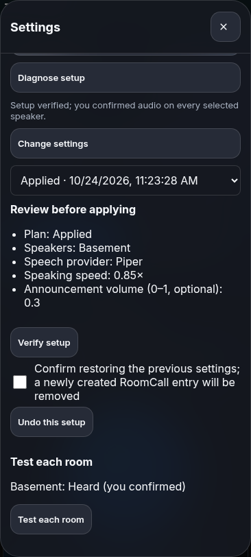

# Guided setup for people and agents

RoomCall lets an authenticated Home Assistant administrator discover speakers,
review a persistent configuration plan, apply it, test audio, resume later, and
undo it. The card and `roomcall__setup` tool use the same backend. Ordinary message
tools keep their existing entity permissions and assistant exposure checks.

## Start before a configuration exists

Install RoomCall with HACS and restart HA first. An agent needs HA's normal
integration configuration capability to start a RoomCall user configuration flow:

```http
POST /api/config/config_entries/flow
{"handler":"roomcall","show_advanced_options":false}
```

Opening that flow registers RoomCall's tools and card resources before an entry
exists. It does not select speakers or enable optional services. An installed
integration that has never been opened cannot register its own tools automatically.
If the agent cannot start HA configuration flows, a person opens **Add integration
→ RoomCall** once. Installation and permissions remain managed by HA/HACS.

On current HA, tools are contributed to HA's LLM platform. Older supported HA uses
the selectable **RoomCall** LLM API. External clients use HA's configured MCP
integration. The administrator identity must reach the tool's HA context; an
anonymous automation context cannot administer setup.

## Discover the contract

Call `roomcall__catalog` with `{}`. It returns API version `1.0`, all available operations,
their input schemas and common response envelope, administration/read-only flags,
and the bootstrap recipe. HA's MCP bridge controls which native tool metadata it
forwards; RoomCall exposes response schemas inside this catalog, without assuming
the bridge forwards MCP `outputSchema`.

All operations also work through `roomcall.communicate` or authenticated
`POST /api/roomcall/command` with `{"operation":"setup","request":{...}}`.
Success and failure include `ok` and `api_version`. Errors include stable `code`,
translated `message`, `retryable`, `details`, and executable `next_actions`.

## Setup sequence

These are request bodies for `roomcall__setup`:

| Action | Request and result |
|---|---|
| Discover | `{"action":"discover"}` returns endpoints, availability, eligibility, areas, deduplicated recommendations, permitted TTS providers, current settings, settings schema, and unresolved questions. |
| Plan | `{"action":"plan","settings":{"speakers":["media_player.kitchen"],"tts_engine":"tts.piper","volume":0.35}}` validates and saves a draft; returns its `id`, `revision`, `settings`, `changes`, and `questions`. No audio plays. |
| Apply | `{"action":"apply","id":"PLAN","revision":"REVISION"}` applies through HA's native config/options flow. Repeating an unchanged apply is safe. |
| Verify | `{"action":"verify","id":"PLAN"}` separates configuration readiness, provider readiness, endpoint availability, human audio confirmation, and overall completion. Follow its `next_actions`. |
| Test | `{"action":"test","id":"PLAN","speaker":"media_player.kitchen"}` plays the existing test sound and returns a job ID. Poll `roomcall__status`. |
| Confirm | `{"action":"confirm","id":"PLAN","speaker":"media_player.kitchen","heard":true}` records what a person reports. An agent must ask the person; it cannot infer this from a successful job. |
| Skip | `{"action":"skip","id":"PLAN","speaker":"media_player.kitchen"}` records a skipped, unverified speaker. It never supplies a listening confirmation. |
| Resume | `{"action":"list"}` lists the caller's active plans. `{"action":"get","id":"PLAN"}` retrieves one. |
| Undo | `{"action":"undo","id":"PLAN","revision":"REVISION","confirm":true}` restores the exact previous options or removes only the entry created by this plan. |

Only one available TTS provider can be selected automatically. With zero or
multiple providers, choose explicitly or set `media_only:true` when planning a
recorded-audio-only installation. Volume is optional. Nested settings patches
preserve unrelated saved values; `null` removes an optional override (HA's initial
entry value still applies if present, and is shown in the plan). Review
`changes` before applying, including defaults added by HA's schema.
Listening confirmations belong to the plan that issued the test. Confirming an
unrelated or older test does not verify a new setup. Retesting clears the previous
confirmation until a person answers again. Endpoint `result` values are `heard`,
`not_heard`, `skipped`, or `untested`; unsuccessful listening results include a
`troubleshooting_url`. Discovery and downloaded diagnostics expose the same saved
`audio_verification`, with `configuration_current` and `audio_confirmed` flags.

Plans belong to their creator, survive HA restarts, expire after 24 hours, and
carry configuration revisions. Intervening changes return `configuration_conflict`
instead of overwriting them. Interrupted apply/undo operations reconcile a native
commit on retry. Undo refuses to remove a new entry if announcements were added
afterward. Store capacity is 32 plans; expired, draft, or rolled-back plans may be
evicted. Undo does not undo previously delivered audio or unrelated HA changes.

The card's **Settings → Setup and sound tests → Guided setup** provides discovery, speaker
selection, speech provider, volume, review, apply, resume, sound tests, verification,
and explicitly confirmed undo. It uses native controls and HA theme colors.



## Receiver and TV routes

Discovery reports audio-URL eligibility separately from app/remote controls. Use
Cast for Android TV audio and paired Android TV Remote for supported wake/app
restoration. Check `endpoint.interruption` and `catalog.playback_routes` before
planning an explicit receiver/HDMI route under `communication.playback_routes`.
Controllers need their own HA permissions and assistant exposure. The shared setup
plan validates these settings without playing audio; review the recipient preview
and run a sound test after applying. Restoration observations are separate from
request acceptance and do not guarantee recovery of a provider-owned session.
See [routes and limits](communication.md#playback-device-routes).

## Announcement administration

Use `roomcall__announcements`, restricted to authenticated administrators:

1. `{"action":"schema"}` retrieves scheduled and triggered field schemas.
2. `{"action":"create","kind":"scheduled","idempotency_key":"weekday-bus","values":{"name":"School bus","time":"07:30:00","days":["mon","tue","wed","thu","fri"],"message":"Bus in ten minutes","rooms":["kitchen"]}}` creates through HA's native subentry flow.
3. `{"action":"list"}` returns IDs, values, enabled state, and revisions.
4. `update` takes `id`, current `revision`, and partial `values`. `enable` and
   `disable` take `id` and current `revision` and operate the native enabled switch.
5. `delete` takes `id`, current `revision`, and explicit `confirm:true`.

Templates, targets, exposure, permissions and native field validation are checked
before saving. Retry the same create with the same idempotency key to retrieve
the same announcement. If it was subsequently edited, the retry returns its current
values without overwriting them. Changed create payloads conflict; deleted
announcements are not resurrected by retrying their retained key. Up to 128
idempotency records persist locally, with oldest-record eviction. This bounded
history is not an indefinite guarantee after eviction.

## Diagnose and recover

`roomcall__doctor` with `{}` reports unavailable/missing selected players, active
Do Not Disturb and quiet hours, human-reported silence, accepted requests without
matching playback reports, unavailable/ambiguous TTS, and suspicious media URLs.
Loopback, `.local`, and default Docker bridge findings link to HA Repairs; missing
URLs and general HTTPS guidance link to network settings. The URL repair proposes
a source IP from HA’s network integration and requires explicit human confirmation
before changing the shared internal URL. These checks do not prove speaker access.

An alternative route is proposed only when an available eligible entity shares a
registry device, stable MAC, verified manufacturer/model/serial identity, or explicitly
configured physical-speaker alias. Model
or room similarity is insufficient. To review one, call
`{"action":"plan_route","speaker":"media_player.old","alternative":"media_player.alternate"}`.
The returned setup plan must still be reviewed, applied, tested and verified.
Diagnosis never changes network settings, exposure, DND, urgency, cloud providers,
or retention automatically.

## Acceptance measurements

CI exercises the native HA LLM tool API using deterministic protocol-agent journeys:
fresh setup to explicit human confirmation, and interrupted apply/undo across stored
state reload. Additional tests cover stale plans, denied permissions, diagnosis,
physical route proposals, announcement CRUD, retries and native-flow failures.
The CI summary reports tool calls, configuration questions, human listening
confirmations, completion, recovery and documentation lookups per recorded journey.
These are protocol tests with mocked devices/providers and scripted human answers,
not an external language model benchmark or a physical-speaker certification.

Runtime diagnostics retain bounded local setup-completion counters/session timings
and delivery observations by route. Device audio-fetch/playback latencies remain
separate from acoustic first-audio latency, which stays unknown without a real
measurement. Existing job idempotency/deduplication and evidence checks test against
duplicate delivery and incorrect success reports. Unknown missed/heard messages
remain unknown. Python statement coverage is gated at 100% for both supported HA
test versions and the standalone package; browser QA checks narrow layouts,
guided setup and consent-based WebRTC.
