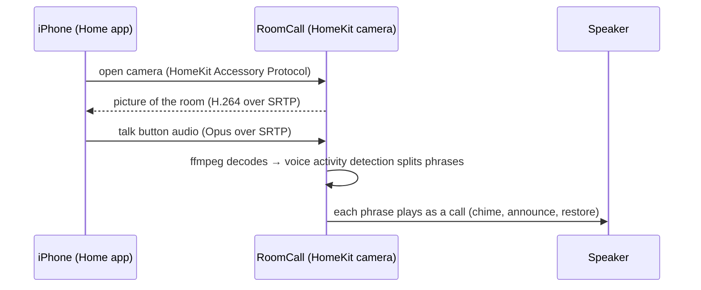

# Apple Home intercom

This page describes the optional camera talk-back bridge. The
[native iOS app](native-ios.md) provides a separate SwiftUI
client that broadcasts directly through HA, without a camera tile. Neither route
registers RoomCall as a member of HomePod's built-in Intercom system.

Talk to any room from the **Home** app, your **Apple Watch** or **Control Center** — even on a
HomePod-free, all-Sonos house. RoomCall adds each room to Apple Home as a camera with a talk
button; what you say plays in that room with the chime first, exactly like a call from the card.

## Turn it on

1. **Settings → Devices & services → RoomCall → Configure → Apple Home** → turn on
   *Add rooms to Apple Home*.
2. A notification shows a pairing code. In the **Home** app: **+** → **Add Accessory** →
   **More options…** → **RoomCall**, and enter the code.
3. Assign each room camera to the matching room in Apple Home.

## Talk to a room

Open the room's camera tile and tap the **microphone**, then talk. The room starts hearing you
(chime first) as soon as you start speaking, and the call ends when you pause or turn the
microphone off, so you can keep it on for a back-and-forth.

- **Apple Watch:** open the Home app → the camera → tap the microphone.
- **Control Center:** add the Home controls and pin the room camera.
- Calls show up in history and notifications as coming from **Apple Home**.

## How it works

The camera "video" is a picture of the room name — RoomCall has no camera, it only uses the
camera tile for its talk button. Nothing leaves your network.

## Troubleshooting

- **RoomCall doesn't appear when adding an accessory.** HomeKit uses mDNS (Bonjour). The iPhone
  and Home Assistant must be on the same network, or mDNS must be reflected between VLANs.
- **Port in use.** Change *HomeKit port* (default 21099) if another bridge uses it.
- **Nothing plays.** Open the camera, tap the microphone, say a full sentence and pause. Check
  `sensor.roomcall_last_call` for the call and its delivery.
- **Start over.** Remove RoomCall from the Home app, turn the option off and on again, and pair
  with the new code.
