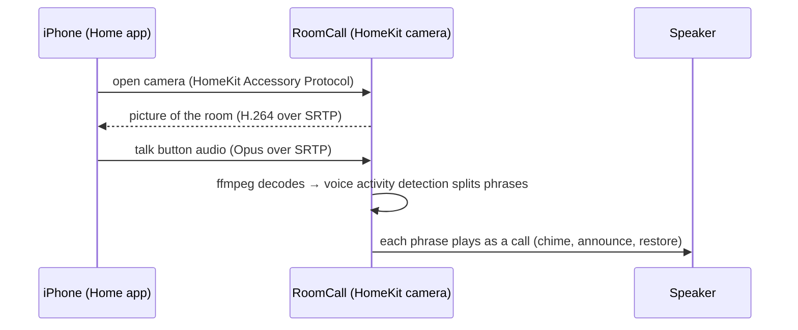

# Apple Home intercom

This page describes the optional camera talk-back bridge. The
[native iOS app](native-ios.md) provides a separate SwiftUI
client that broadcasts directly through HA, without a camera tile. Neither route
registers RoomCall as a member of HomePod's built-in Intercom system.

Talk to any room from the **Home** app, your **Apple Watch** or **Control Center** — even on a
HomePod-free, all-Sonos house. RoomCall adds each room to Apple Home as a camera with a talk
button; what you say plays in that room with the chime first, exactly like a call from the card.

## Turn it on

1. **Settings → Devices & services → RoomCall → Configure → Apple Home** → turn on
   *Add rooms to Apple Home*.
2. A notification shows a pairing code. In the **Home** app: **+** → **Add Accessory** →
   **More options…** → choose a room's **Intercom** accessory and enter the code.
3. Repeat for each room camera and assign it to the matching Apple Home room.
   Rooms are separate accessories, using consecutive ports from the configured
   HomeKit port (default 21099), rather than cameras behind one bridge.

## Talk to a room

Open the room's camera tile and tap the **microphone**, then talk. Voice activity
starts a live phrase stream, with the configured chime. Pausing or turning the
microphone off ends that phrase; buffering and active queues can delay actual
playback. Keeping the microphone on can send subsequent phrases; a speaker's own
microphone is not a return-audio channel.

- **Apple Watch:** open the Home app → the camera → tap the microphone.
- **Control Center:** add the Home controls and pin the room camera.
- Calls show up in history and notifications as coming from **Apple Home**.

## How it works

The camera "video" is a generated room-name picture, not footage of the room.
RoomCall uses the camera tile for its talk button. The HomeKit connection and HA
speaker route handle this audio; remote Home access and optional notifications or
speech processing follow your Apple Home/HA configuration.

## Troubleshooting

- **RoomCall doesn't appear when adding an accessory.** HomeKit uses mDNS (Bonjour). The iPhone
  and Home Assistant must be on the same network, or mDNS must be reflected between VLANs.
- **Port in use.** Choose an unused consecutive port range starting at *HomeKit port*
  (default 21099), with one port per room.
- **Nothing plays.** Open the camera, tap the microphone, say a full sentence and pause. Check
  `sensor.roomcall_last_call` for the call and its delivery.
- **Start over.** Toggling the option preserves pairing state and the code; it is
  not a factory reset. Remove/re-add the affected room accessory in Apple Home
  using the displayed code. If pairing still fails, collect diagnostics before
  changing stored pairing state.
