# Home Assistant

RoomCall is a native Home Assistant integration. It runs **inside** Home Assistant, so there is no
separate server: your speakers are the media players Home Assistant already controls, and your
rooms are Home Assistant areas.

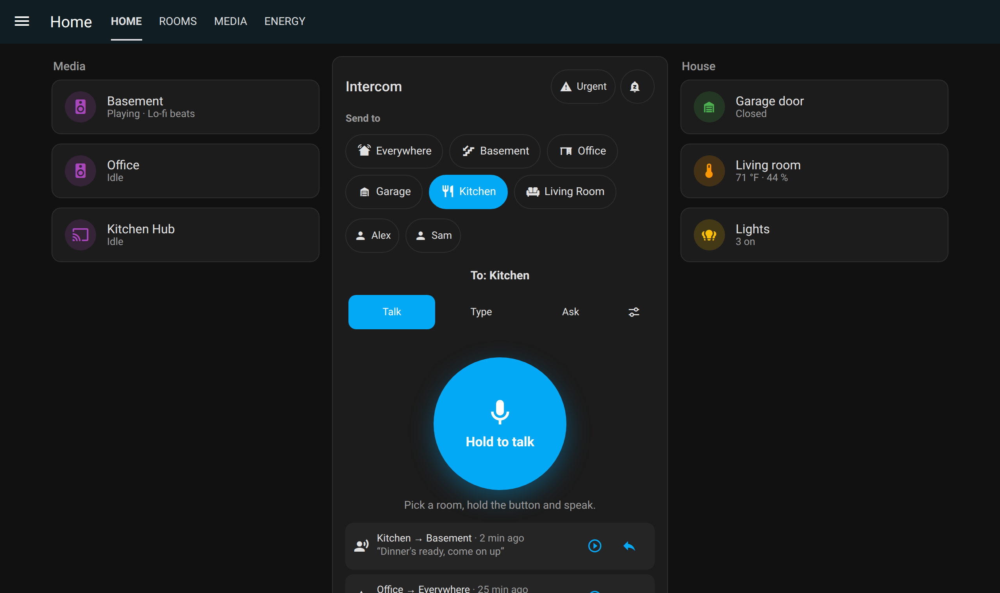

Screenshots render the real card with sample data and simulated devices in a test
harness. See [capture sources and validation limits](screenshots.md).

## Before you start

- **Home Assistant 2025.6** or newer, with [HACS](https://hacs.xyz/docs/use/) installed.
- **HTTPS or the companion app** for the microphone. Browsers only allow the mic on secure pages,
  so open Home Assistant through Nabu Casa, a reverse proxy, Tailscale, or the mobile app.
- **A reachable internal URL.** Speakers download each clip from Home Assistant. Check
  *Settings → System → Network → Local network* is an address your speakers can reach
  (for example `http://192.168.1.10:8123`).

2025.6 is the declared integration minimum; CI exercises HA 2026.2.3 and 2026.10.2.
The [native app](native-ios.md) requires HA 2026.10 or later for PKCE sign-in.

## 1. Install

=== "HACS (one click)"

    [](https://my.home-assistant.io/redirect/hacs_repository/?owner=daredoole&repository=RoomCall&category=integration)

    Click **Download**, then restart Home Assistant.

=== "HACS (manual)"

    1. HACS → ⋮ → **Custom repositories**.
    2. Add `https://github.com/daredoole/RoomCall` as type **Integration**.
    3. Search **RoomCall** → **Download** → restart Home Assistant.

=== "Without HACS"

    Download `roomcall.zip` from the
    [latest release](https://github.com/daredoole/RoomCall/releases/latest), unzip it into
    `/config/custom_components/roomcall/` and restart Home Assistant.

## 2. Add the integration

[](https://my.home-assistant.io/redirect/config_flow_start/?domain=roomcall)

Or go to **Settings → Devices & services → Add integration → RoomCall**.

After setup, open the card’s **Settings → Setup and sound tests** and apply a guided
setup plan. **Test each room** plays one selected speaker at a time. Answer **Yes**
only when you hear it; **No** shows a troubleshooting link, and **Skip** leaves that speaker
unverified. Reports survive a reload and appear in integration diagnostics and setup
tools. A playback request being accepted never counts as a listening confirmation.

Pick your speakers. Everything else is under **Configure** on the integration:

| Option | Default | What it does |
|---|---|---|
| Speakers | announce-capable players | Media players that make up the intercom |
| Announcement volume | speaker's current volume | Fixed volume for calls (Sonos) |
| Microphone boost | 0 dB | Raise if phone recordings sound quiet |
| Text-to-speech engine | your default | Used by `roomcall.broadcast` messages |
| Speaking speed | 1 | 0.5–1.5. Lower it (try 0.85) if typed messages and announcements sound rushed; pitch is unchanged. Also in the card's **Settings → Setup** |
| **Chime** → chime | Walkie-talkie chirp | Chirp, ding, double beep, rising tones, doorbell, or none |
| **Chime** → custom file or URL | — | Your own sound, e.g. `/config/www/chime.mp3`; overrides the chime |
| **Delivery** → delay between speakers | 250 ms | Stops several Sonos in one home from dropping the same announcement |
| **Delivery** → retry | on | Tries a failed speaker once more after a second |
| **Delivery** → urgent call volume | 0.8 | Volume for urgent calls |
| **Quiet hours** → start / end / volume / rooms to skip | off | Quieter calls at night that skip bedrooms |
| **Notifications and replies** → phones | none | Phones notified about each call (not the caller's own) |
| **Notifications and replies** → dashboard | — | Path of the dashboard with the card; adds a **Reply** button |
| **Notifications and replies** → speech-to-text | none | Adds what was said to notifications and history |

!!! tip "One entity per speaker"
    A physical speaker often has several media players (native Sonos plus Music Assistant, Cast
    plus Android TV…). Pick one per speaker so messages do not play twice. RoomCall suggests
    announce-capable native entities and skips Music Assistant mirrors by default.

!!! info "Rooms come from areas"
    Each speaker's room is its entity area, or its device area. Speakers without
    an area remain available through **Everywhere** or an explicit speaker ID,
    but have no room button — assign them in *Settings → Areas*.

## 3. Add the push-to-talk card

The integration registers the card automatically — no dashboard resource needed. Edit a
dashboard → **Add card** → **RoomCall** and set it up in the visual editor, or paste:

```yaml
type: custom:roomcall-card
title: Intercom
# optional:
room: kitchen                  # where this card is; replies come back here
default_room: basement         # room preselected
rooms: [kitchen, living_room]  # limit the room buttons
people: true                   # person buttons (true, false, or a list of person entities)
history: 3                     # recent calls to show (0 to hide)
layout: default                # default, compact or kiosk
appearance: glass              # glass (Apple-like), material, or home-assistant (your dashboard theme)
theme: auto                    # auto (follows Home Assistant), light or dark
color: "#0a84ff"               # talk button colour; Material builds its whole palette from it
live: true                     # stream while you talk (false: record, then send)
```

<div class="grid" markdown>
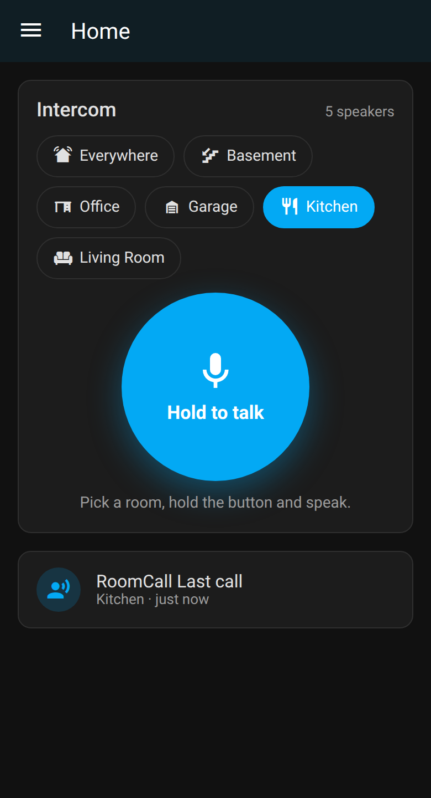{ width="240" }
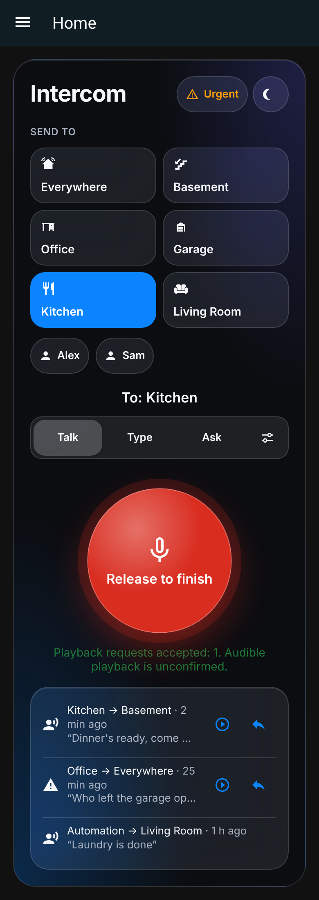{ width="240" }
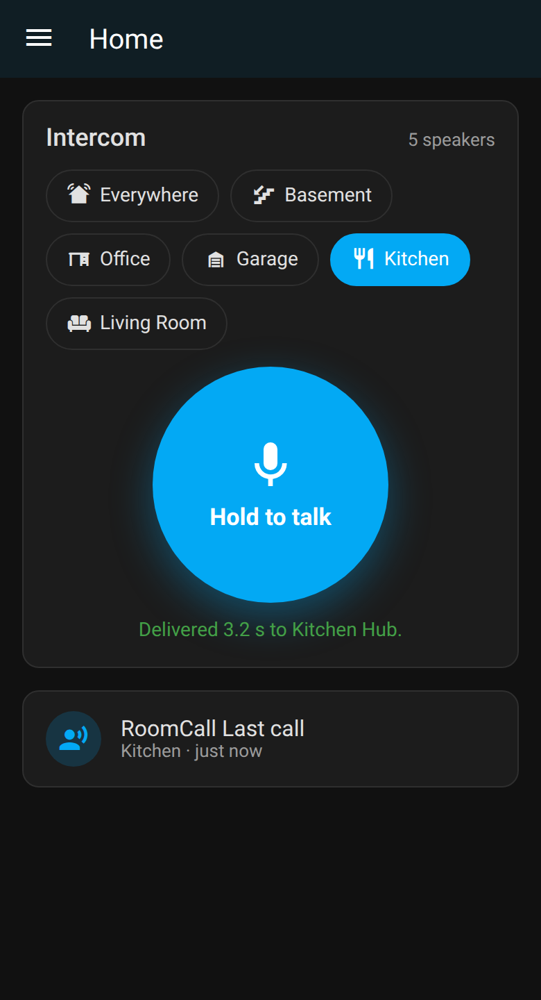{ width="240" }
</div>

Hold the button and talk. With **live calls** (the default), audio streams while
you hold the button. Speaker startup, buffering and queues determine when playback
begins and ends; release ends capture, not necessarily speaker playback. Set
`live: false` to record the whole message first and then send it. The card reports
playback-request acceptance and separate device evidence, not whether anyone heard it.
If your microphone records silence (wrong input
selected), the card says so instead of sending an empty clip.

- **Urgent** (top right) plays the next call at the urgent volume and ignores Do Not Disturb
  and quiet hours.
- **Bell** toggles **Do Not Disturb**: only urgent calls play while it's on.
- **People** buttons call whoever you tap in the room they're in (see [Call a person](#call-a-person)).
- **Recent calls** can be replayed in the browser, and **Reply** aims the card back at the caller.

### Layouts

<div class="grid" markdown>
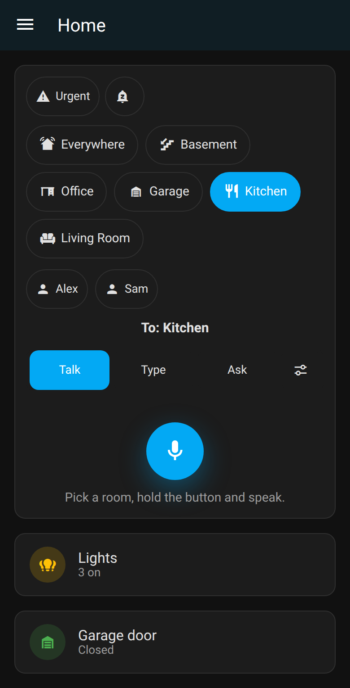{ width="240" }
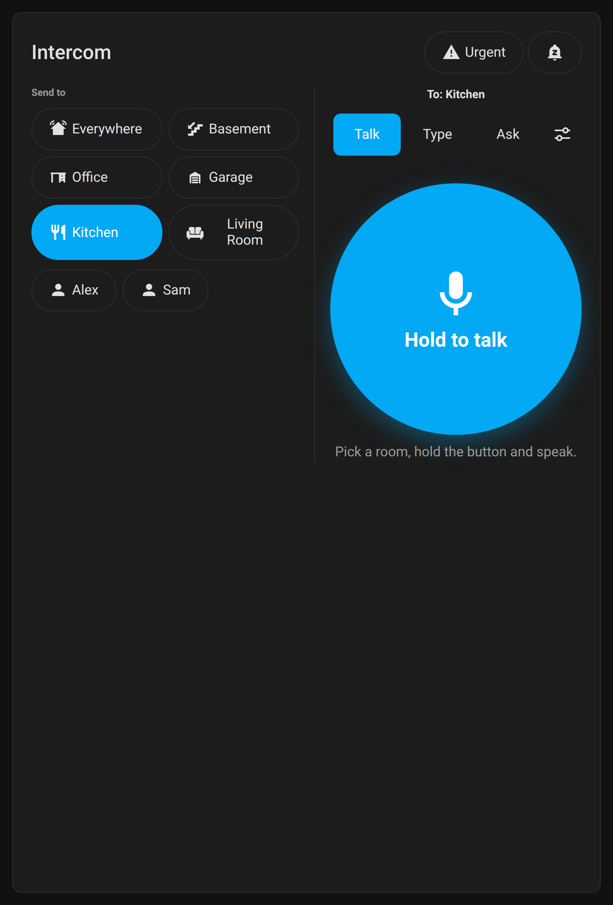{ width="240" }
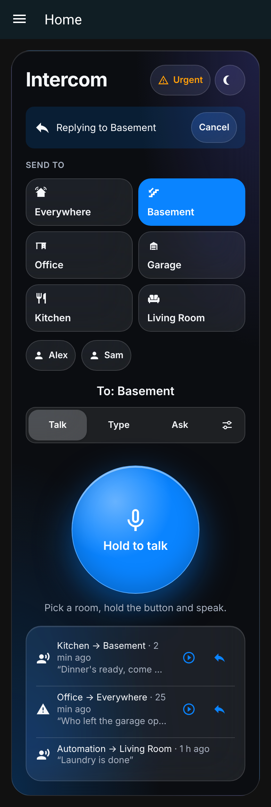{ width="240" }
</div>

`compact` reduces the talk control's size while retaining destination and messaging
controls. It still needs space for wrapped room buttons. `kiosk` provides a big
button for a wall tablet.

### Settings panel

Tap the sliders icon next to Talk / Type / Ask for **Settings**:

<div class="grid" markdown>
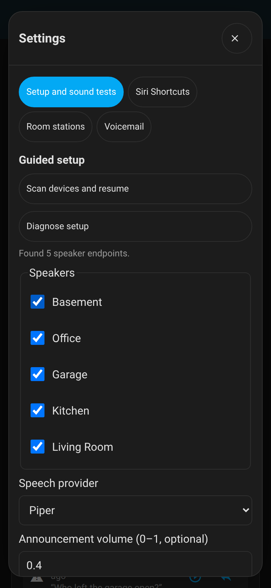{ width="200" }
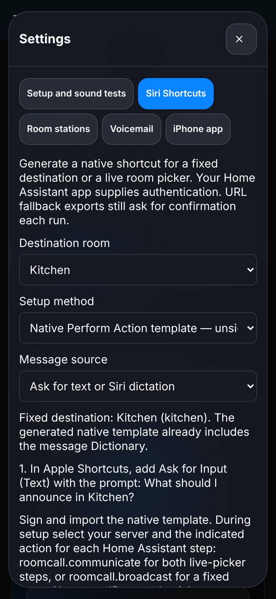{ width="200" }
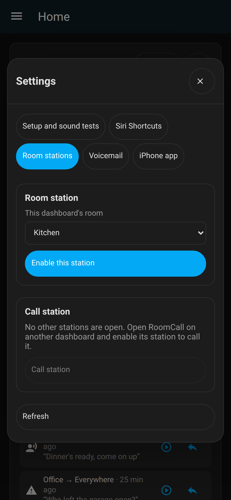{ width="200" }
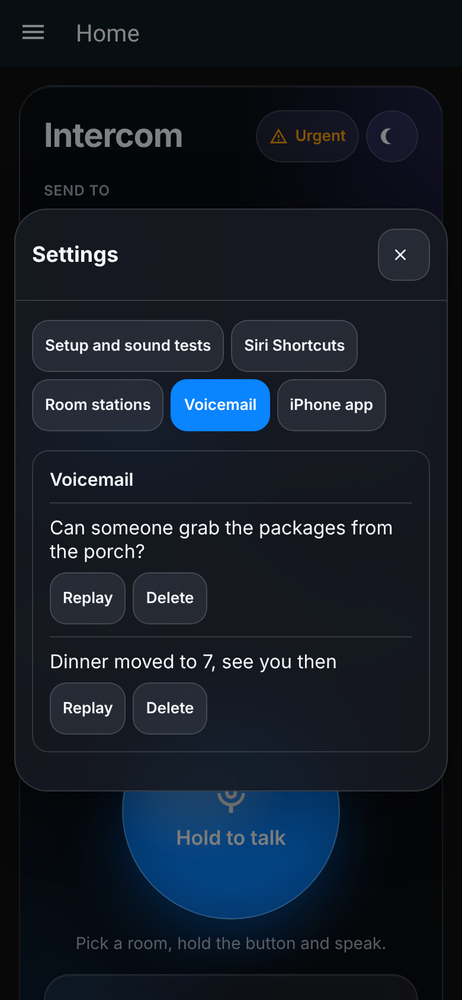{ width="200" }
</div>

- **Setup and sound tests** — guided setup (scan, review a plan, apply, undo) and a test
  sound per speaker that you confirm you heard ([details](agent-setup.md)).
- **Siri Shortcuts** — per-room or live-picker shortcuts ([guide](siri-shortcuts.md)).
- **Room stations** — make this dashboard callable from other dashboards ([details](communication.md#browser-room-stations)).
- **Voicemail** — appears when voicemail is enabled in the options.

### To do

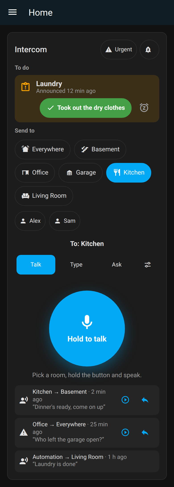{ width="260" align=right }

Announcements with a **task to confirm** appear at the top of the card while they're open.
The green button carries the task's own words (*Took out the dry clothes*); the snooze icon
reminds again in 30 minutes. There is deliberately no dismiss button
([how tasks work](announcements.md#tasks-confirm-it-was-actually-done)).

Cards use automatic height in Sections dashboards so wrapped room buttons, messaging
forms and expanded setup push the next card down. If an existing dashboard pins a
row count, the card scrolls within that space. Remove the saved row count, or set
`grid_options: {rows: auto}`, to let it grow with its contents.

## Replies

With phones and a dashboard path set, every call sends a notification such as
**Kitchen → Basement: "dinner's ready"** with a **Reply** button. Tapping it opens your dashboard
with the card already aimed back at the caller's room, so you just hold and talk. The caller's own
phones are skipped.

For replies to know where a call came from, set `room:` on each card (for example the kitchen
tablet's card gets `room: kitchen`).

!!! note "Replying without a phone"
    Sonos, HomePod and Nest speaker microphones are reserved for their own voice assistants.
    Add a small Assist satellite to the room and turn on
    [hands-free talk-back](communication.md#hands-free-talk-back) to answer out loud.

## AV receivers and TV boxes

RoomCall requests `announce: true` only when a player advertises support. Mixing,
ducking and interruption behavior depend on the integration and device. Other
routes — such as HEOS receivers or TV boxes through Cast — may interrupt the
current source. With restoration enabled, RoomCall attempts to restore supported
state after the playback lease:

| Before the call | After the call |
|---|---|
| Receiver on the TV input | Switched back to the TV input, same volume |
| Receiver off | Turned back off |
| TV box in Netflix, YouTube… | The same app reopened (where you were in it is up to the app) |

RoomCall pairs controls using a shared registry device, MAC address, or a verified
manufacturer/model/serial identity, or explicit physical-speaker aliases. A matching
model and room alone are insufficient. For a receiver, choose its **HEOS** entity
as the speaker and add **Denon AVR Network Receivers** for power/input control.
For Android/Google TV, choose its **Cast** entity and add **Android TV Remote** for
wake-up, app reopening and supported play/pause commands. Remote-control entities
are not advertised as audio-URL players merely because they can launch apps.

Before playback, RoomCall wakes a verified control when needed, selects the known
input (HEOS Music for a paired HEOS receiver), and confirms the reported state.
Preparation failure stops dispatch and attempts to undo the temporary changes.
Power, input, volume and mute are saved for restoration. Attributes hidden in
standby are captured after wake and before overrides. Lost connectivity can prevent
restoration; its request outcome is separate from playback acceptance/audibility.

**Preview recipients** identifies the controller/source and the restoration
limitations. The delivery timeline reports pending, completed, failed or skipped
restoration separately. A changed Cast session, externally changed receiver input,
or revoked permission prevents RoomCall from overwriting that newer state.

Plain replayable Cast media can be loaded at its last reported position where
supported, preserving paused/playing state. Android apps can be reopened and sent
supported transport commands. DRM, expired URLs and provider-owned sessions may
prevent full recovery; reopening Netflix does not guarantee the same episode or
timestamp. Recognizable RoomCall/TTS URLs are not resumed as background media.

!!! tip "Receiver plus TV box in one room"
    If a TV box plays through the receiver, select one audio route for that output.
    HEOS uses the receiver’s network input; changing that input may also affect video.
    To interrupt the box itself, use its Cast endpoint, paired Android controls and an
    explicit receiver/HDMI route. Restoring the receiver input alone does not pause
    or rewind a program running on another device.

Turn this off under Configure → Delivery → *Put speakers back after a call*.
An explicit/verified receiver route can still prepare its input when restoration
is disabled; it then leaves that input selected. HDMI wiring requires an explicit
[playback route](communication.md#playback-device-routes); it is not inferred from
room names. Selecting multiple entities sharing the same output does not send
duplicate audio, and calls using that output share a playback lease.

## Do Not Disturb and quiet hours

- `switch.roomcall_do_not_disturb`: while on, normal calls are refused and urgent calls still play.
  Turn it on in your bedtime routine.
- **Quiet hours** (Configure → Quiet hours): calls play at the quiet volume and skip the rooms you
  pick (for example the kids' rooms). The card tells you which rooms were skipped.

## Call a person

`people: [person.alex]` in the action, or a person button on the card, plays wherever that
person is right now. RoomCall follows the person's device trackers to a room-presence sensor
(any `sensor.*_area` on the same device, as [Bermuda](https://github.com/agittins/bermuda)
creates), or uses a tracker or sensor whose state is an area name. If it can't tell where they
are, the call is refused instead of playing in the wrong room.

## `roomcall.broadcast` action

Speak a message (text-to-speech) or play an audio URL in rooms or wherever people are:

```yaml
action: roomcall.broadcast
data:
  areas: [kitchen, basement]   # omit for every RoomCall speaker
  message: Dinner is ready
  volume: 0.4                  # optional, Sonos
```

```yaml
action: roomcall.broadcast
data:
  people: [person.alex]
  message: Your ride is here
  priority: urgent             # louder, ignores Do Not Disturb and quiet hours
```

```yaml
action: roomcall.broadcast
data:
  areas: garage
  media_url: http://homeassistant.local:8123/local/chime.mp3
```

RoomCall prepares its configured chime and speech together; Chime TTS is not required.
With the chime off, it uses HA's direct TTS route. The action returns per-speaker
request results, so scripts can react to failures:

```yaml
- action: roomcall.broadcast
  data: { areas: basement, message: "Laundry is done" }
  response_variable: call
- if: "{{ not call.ok }}"
  then:
    - action: notify.mobile_app_phone
      data: { message: "Basement playback request failed; check RoomCall history" }
```

Siri, Apple Watch and CarPlay can call this too — see [Siri and Shortcuts](siri-shortcuts.md).

## Entities

- `notify.roomcall_<room>`: one per room — `notify.send_message` speaks the message there
  (see [Blueprints](blueprints.md#room-notify-entities)).
- `sensor.roomcall_last_call`: time of the last call, with attributes `target`, `from`, `kind`
  (`talk`, `message`, `media`), `priority`, `delivered`, `failed`, `skipped`, `text`, and
  `history` (the last 10 calls).
- `switch.roomcall_do_not_disturb`: see above.
- Per announcement (its own device, *Announcement: name*): `button.<name>_play_now` and
  `switch.<name>_enabled`, whose attributes describe the schedule or trigger, targets,
  `last_played` and `last_error`. See [Announcements](announcements.md).

AI agents and voice assistants: see [Managing RoomCall with AI](ai.md) — the `RoomCallAnnounce`
Assist intent, every action and field, and how announcements are created through the API.

## Diagnostics and Repairs

- **Repairs** (Settings → System → Repairs) flag speakers that are unavailable, a missing local
  network URL, or an HTTPS internal URL that speakers may refuse.
- **Download diagnostics** on the RoomCall integration for bug reports. What people said
  (messages and transcripts) and phone names are removed.

## How playback works

**Live calls** (the default) stream from the card over Home Assistant's WebSocket: ffmpeg encodes
the audio to MP3 as it arrives (chime first) and speakers play one growing URL, so they start
while you are still talking. **Recorded calls** (`live: false`, typed messages and automations)
are prepared before dispatch. RoomCall-hosted recording/chime clips use an
unguessable URL available for up to two minutes; external URLs and direct TTS
have their own provider lifetimes.
Either way each speaker gets `media_player.play_media`, a short moment apart. Speakers that support it get `announce: true`,
so Sonos lowers the music instead of stopping it.

Uploads, history and replays require a signed-in Home Assistant user. Clip and chime URLs are
unauthenticated because speakers cannot sign in, which is why clips are random and short-lived.
History holds at most 20 records in memory. Available recording audio expires after
24 hours (or earlier through eviction/reload); record metadata can remain until
eviction/reload. The sensor exposes the last 10 records. Optional voicemail and
durable jobs explicitly persist their own data in HA storage; prepared speech
uses a separate bounded in-memory cache. See [retention settings](communication.md).

!!! warning "Keep the internal URL on plain http"
    Speakers download clips from Home Assistant's internal URL. If you put Home Assistant behind
    a reverse proxy with a home-made certificate for the microphone, leave the **internal URL** on
    `http://<ip>:8123`: Sonos and Cast speakers can't trust a home-made certificate.
