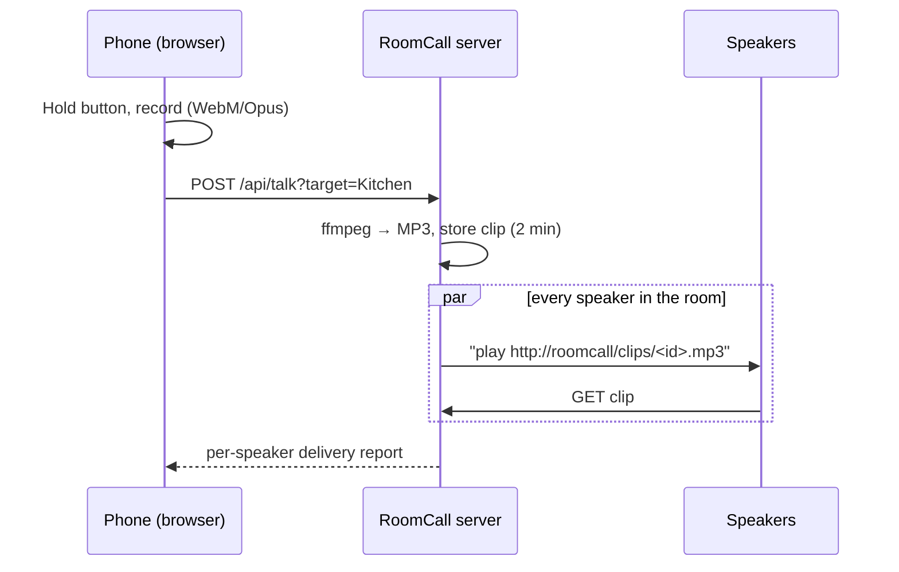

# How it works

This page describes the **standalone server**. The Home Assistant integration also
supports [live streaming, message jobs and optional retention](communication.md).
Its [playback pipeline](home-assistant.md#how-playback-works) is different.

1. **Discovery** browses mDNS for `_sonos._tcp`, `_raop._tcp`, `_airplay._tcp` and
   `_googlecast._tcp`, then keeps one entry per device, preferring native Sonos control.
2. **Recording** happens in the browser with echo cancellation and noise suppression.
3. **Conversion** uses ffmpeg to prepare mono 128 kbps MP3; device support still needs testing.
4. **Fan-out** sends the clip URL to every target speaker in parallel. Each backend:
    - **Sonos** — snapshots the current queue/volume, plays the clip, restores with a fade.
    - **AirPlay** — streams the clip with pyatv.
    - **Cast** — plays the clip through the default media receiver.
5. **Clips** live in memory for two minutes behind unguessable ids, then disappear.

## Latency

The standalone browser records first and uploads after you **release** the button.
Delay includes upload, conversion and the chosen backend's startup/buffering.
There is no hardware latency benchmark or fixed timing guarantee. A successful
backend result does not establish audibility, and the Sonos backend can await
playback/restoration before returning its result.

Live streaming is implemented in the Home Assistant integration, not in this
standalone API. Different devices and routes can start at different times.

## Privacy

The standalone server holds clips in memory and stops serving them after two
minutes (or earlier through bounded-store eviction). Delivery goes to the speaker
addresses you configure/discover; transport and network exposure are your deployment's
responsibility. Set a `token` and use HTTPS if untrusted clients can reach the server.
