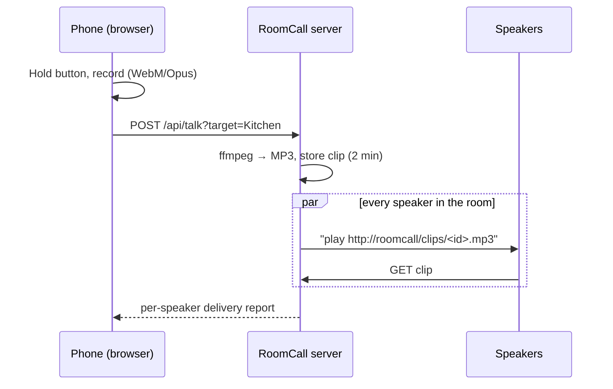

# How it works

1. **Discovery** browses mDNS for `_sonos._tcp`, `_raop._tcp`, `_airplay._tcp` and
   `_googlecast._tcp`, then keeps one entry per device, preferring native Sonos control.
2. **Recording** happens in the browser with echo cancellation and noise suppression.
3. **Conversion** turns the recording into mono 128 kbps MP3 that every speaker accepts.
4. **Fan-out** sends the clip URL to every target speaker in parallel. Each backend:
    - **Sonos** — snapshots the current queue/volume, plays the clip, restores with a fade.
    - **AirPlay** — streams the clip with pyatv.
    - **Cast** — plays the clip through the default media receiver.
5. **Clips** live in memory for two minutes behind unguessable ids, then disappear.

## Latency

RoomCall is half-duplex push-to-talk: the delay is measured from when you **release** the button.

| Speaker | Typical delay | Why |
|---|---|---|
| Sonos | 1–1.5 s | Speaker downloads the clip and starts its player |
| Cast | 1–2 s | Receiver app launch on first play |
| AirPlay | ~2 s | AirPlay's fixed playback buffer |

Live, streaming audio while you are still talking is on the [roadmap](roadmap.md); it lowers the
perceived delay but cannot beat each protocol's own buffer.

## Privacy

Recordings never leave your network. Nothing is written to disk; clips are dropped after two
minutes. Set a `token` if anything untrusted can reach the server.
