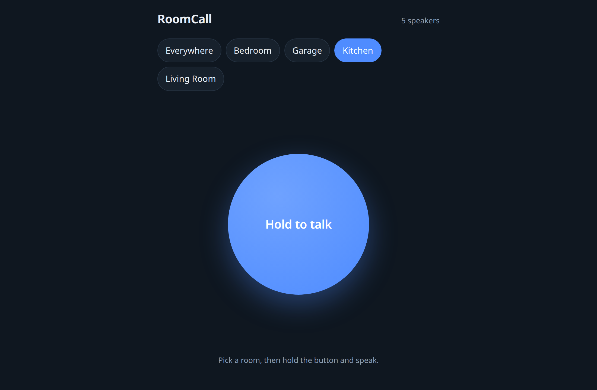

# RoomCall

**Push-to-talk intercom for Home Assistant, on the speakers you already own.** Hold a button,
talk, and your voice plays in the room you picked — on Sonos, AirPlay and Google Cast speakers.

[](https://my.home-assistant.io/redirect/hacs_repository/?owner=daredoole&repository=RoomCall&category=integration)

<div class="grid" markdown>
{ width="240" }
{ width="240" }
{ width="240" }
</div>

## What you get

- **Hold-to-talk card** for any dashboard, in the Home Assistant app or browser.
- **Rooms are your areas** — talk to one room or everywhere at once.
- **Walkie-talkie chirp** before each message, and **announce mode** so Sonos ducks the music.
- **`roomcall.broadcast`** for automations: text-to-speech or audio files, per area.
- **Local only** — no cloud, no accounts; audio never leaves your network.

[Set it up in Home Assistant →](home-assistant.md){ .md-button .md-button--primary }
[Run it without Home Assistant](getting-started.md){ .md-button }

## Try the standalone app in 30 seconds

No Home Assistant? RoomCall also runs as its own server with mDNS speaker discovery.

```bash
pipx install roomcall
roomcall serve --demo
```

Open <http://localhost:8765>, pick a room and hold the button. Demo mode uses fake speakers, so
nothing is played.


