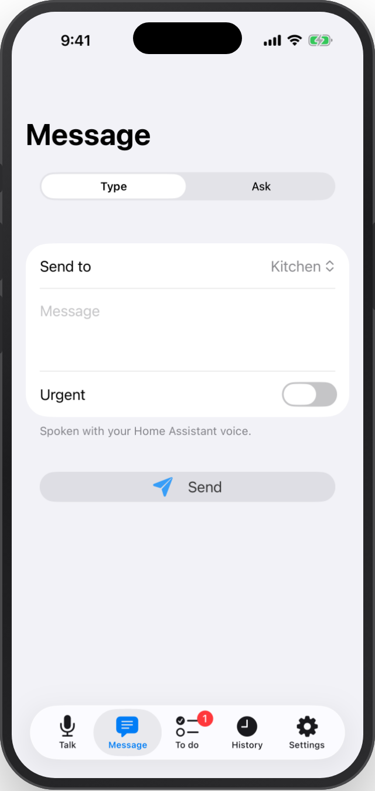
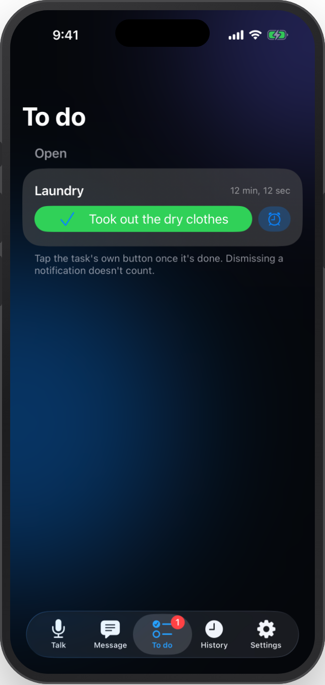

# Native iOS app

RoomCall includes a sideloadable SwiftUI iPhone/iPad app in `ios/RoomCall`.
It sends live microphone audio and typed announcements through your Home Assistant.
It uses an ordinary in-app microphone session; Apple's Push to Talk entitlement is
not required. The optional [Apple Home camera bridge](apple-home.md) is a separate route.

<div class="grid" markdown>
{ width="180" }
{ width="180" }
{ width="180" }
{ width="180" }
</div>

## What is implemented

- Home Assistant sign-in through `ASWebAuthenticationSession`, state validation,
  SHA-256 PKCE, token refresh and device-only Keychain storage. No token to paste.
- Connect by entering your HA address, or scan **Settings → iPhone app** on the
  RoomCall dashboard card. The QR code contains a server address, not credentials;
  you still sign in through Home Assistant.
- **Talk:** pick a room, Everywhere or a person, then hold the microphone button.
  Release to finish. VoiceOver users double-tap to start and again to stop.
  Capture starts only after the local action and microphone permission.
- Ordered, bounded live WebSocket audio in mono 16 kHz PCM. Releasing while
  connecting sends no recording. Accepted playback remains separate from audibility.
- **Message:** type to speak in the selected destination, or ask a compatible Assist
  satellite and read its transcribed response.
- **Tasks:** complete or snooze announcement tasks; **History:** read and reply to calls.
- **Settings:** select this phone's usual room for replies, see the server and sign out.
  Do Not Disturb and urgent controls are available in the room interface.
- Foreground doorbell detection with a snapshot and an action opening the HA camera.
  Two-way visitor audio depends on that camera's HA support.
- Siri/Shortcuts room entities and typed announcements, Control Center controls,
  a task widget and task Live Activities with a completion action.
- Dynamic Type, accessibility labels, light/dark appearances and five languages.
  Native translations are generated from the integration catalogs.

## Requirements and installation

- Use the current RoomCall integration release for the complete app features.
  RoomCall 0.10.0 introduced callback metadata; task and doorbell features need later versions.
- Home Assistant **2026.10 or later** for the app's PKCE sign-in flow. This is separate
  from the integration's compatibility tests against HA 2026.2.3 and 2026.10.2.
- iOS/iPadOS **18 or later** is the deployment target; particular controls also depend
  on the installed OS. See the CI logs for the SDK and simulator actually tested.
- A signed build is required on a physical phone. CI produces an **unsigned IPA**;
  it cannot be installed by simply opening the file. Sign it with your own Apple
  identity using a compatible sideloading tool, or build with Xcode. Signing must
  cover the app, widget extension and matching app group. Tool/account limitations apply.

There is no App Store or TestFlight distribution configured. Find the simulator
and unsigned-device artifacts in successful [iOS workflow runs](https://github.com/daredoole/RoomCall/actions/workflows/ios.yml).
Artifact downloads require GitHub access and expire according to GitHub's retention policy.

Use a trusted HTTPS HA address. Local networking is permitted, but certificate
validation is not bypassed and App Transport Security is not globally disabled.
Actual reachability depends on the address, phone and network.

## Build and connect

```bash
brew install xcodegen
python3 scripts/ios_localizations.py --check
xcodegen generate --spec ios/RoomCall/project.yml
open ios/RoomCall/RoomCall.xcodeproj
```

Choose the **RoomCall** scheme and your signing team. If bundle identifiers change,
update the matching app group in `project.yml` and `RoomCache.defaults` in
`Shared/Models.swift`. Generated projects, plists and entitlements are ignored;
`project.yml` is their source.

Install the signed app, enter the HA address or scan the card's connection QR code,
and sign in. Pick a destination and hold to talk, or use **Message** to type.
Opening the app, a room control or a connection link never starts the microphone.

New sign-ins use the public client ID
`https://daredoole.github.io/RoomCall/ios-client.html`, which advertises only
`roomcall://auth-callback`. HA must be able to fetch this small HTTPS page to validate
the redirect. Credentials, authorization codes and tokens are sent only to your HA
server; PKCE and state validation still apply. Existing saved credentials retain
their original client ID for refresh. The local `/roomcall/ios` metadata endpoint
remains available for older clients.

### Sign-in errors

- **TLS / secure connection failed:** if the server uses a private CA, install and
  explicitly trust that CA on the iPhone under **General → About → Certificate
  Trust Settings**. A Safari exception alone is not system-wide trust. The app
  continues validating certificates.
- **Invalid redirect URI:** update the iPhone app to **0.18.1 or later**. Earlier
  builds ask HA to fetch its own local HTTPS callback metadata, which fails when
  HA does not trust that server certificate. Allow outbound HTTPS from HA to the
  public metadata URL above. Updating only the HA integration does not replace
  an already-installed iPhone build.

## Platform boundaries

The app broadcasts outbound audio. It does not provide an always-listening background
receiver, join HomePod's built-in Intercom system, make other speakers Siri accessories,
or register a native Home app Intercom tile. It does not use system Push to Talk channels.

Tasks and doorbells refresh while the app is open. Live Activities and widgets do not
supply a background push service. Background incoming calls or remotely refreshed
activities need additional provisioning, a push service and physical-device testing.
The optional camera bridge remains the route for room talk buttons inside Apple Home.

## Validation

Native CI checks translation synchronization on every PR. Changes to native sources
or resources run unit, UI and screenshot tests plus an unsigned device build. Main
and manual workflow runs also build the app. The device build includes the widget/
Control Center extension and Live Activity. Successful builds upload the IPA and
simulator result bundles.

Simulator tests cover sign-in validation, PKCE/state, storage, audio conversion,
API errors, message/task controls, doorbell presentation and large text. They cannot
prove physical microphone routing, speaker audibility, background wake-up, signing
or App Store eligibility. Python's **100% statement coverage** gates cover the HA
integration and standalone server, not Swift or JavaScript execution. Browser QA
separately exercises narrow/fixed-height layouts, keyboard access and WebRTC cleanup.

## Screenshots

These are actual simulator captures from debug-only demo mode, with sample rooms
and no server credentials. They illustrate the interface, not real speaker delivery.
Frame exported CI captures with:

```bash
python scripts/ios_mockups.py path/to/ios-screenshots
```
