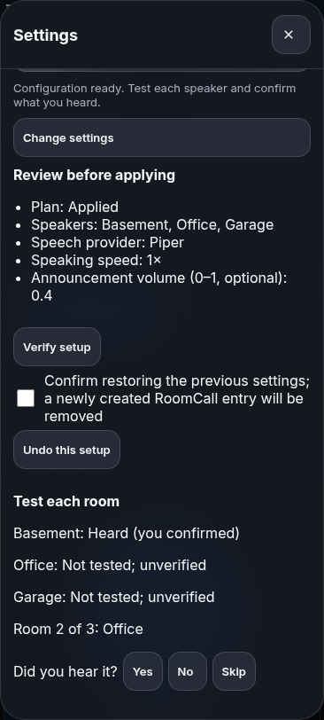

# Screenshots and validation

Browser captures were refreshed from **RoomCall 0.23.0** on
2026-10-26. Native captures retain the compatible **native 0.20.0 / build 4** client.
Home Assistant captures include
the Glass interface and receiver/TV interruption previews and restoration status. The captures illustrate real rendered interfaces with sample data;
they do not demonstrate a particular household, physical speaker delivery or
successful Apple signing. Room names, tasks, people and transcripts are examples.

## Capture sources

| Images | Source | What is simulated |
|---|---|---|
| `ha-*.png`, `demo.gif` | Current card JavaScript rendered by Playwright Chromium in `scripts/ha_card_harness.html` | HA state, users, devices, API results and microphone input |
| `screenshot-*.png` | Actual standalone server running `--demo`, captured by Playwright | Speaker discovery and playback backends; microphone input |
| `ios-*.png` | Actual XCUITest screenshots from [the tested 0.20.0 source run](https://github.com/daredoole/RoomCall/actions/runs/40035013972), framed by `scripts/ios_mockups.py` | Debug-only demo service, rooms, tasks, history and connection results |

The native screen pixels come from the simulator; the surrounding phone frame is
decorative. Screenshots show selected viewports and states, not every possible
device, font size, theme or error. The browser harness supplies HA-like surrounding
dashboard cards; those cards are not shipped as a RoomCall dashboard.

The [capture manifest](assets/screenshots.json) records the capture checkout's base
commit, the iOS source commit/run, and SHA-256 hashes of all captures and their
interface inputs (including capture-script edits on top of that base). CI checks that
assets and recorded inputs still match. This detects drift; it cannot prove that
all prose is correct, that someone heard a message, or that a visual issue is absent.

## Refresh captures

Install the project's development/docs dependencies plus Playwright, ffmpeg and
Chromium. From the repository root, capture all browser states:

```bash
python scripts/ha_screenshots.py
python scripts/qa_communication.py
python scripts/screenshots.py
```

For native captures, first require a successful iOS simulator test run for the
current native source. Download its `roomcall-ios-simulator` artifact, then frame
the exported attachments:

```bash
gh run download RUN_ID --name roomcall-ios-simulator --dir /tmp/roomcall-ios-captures
python scripts/ios_mockups.py /tmp/roomcall-ios-captures/ios-screenshots
```

Review every capture for incorrect states, clipping, personal data and misleading
labels. Record the successful run ID and its source commit; the recorder refuses
native input differences from that commit:

```bash
python scripts/doc_assets.py --record --ios-run RUN_ID --ios-commit SOURCE_COMMIT
python scripts/doc_assets.py
mkdocs build --strict
```

Commit the images and manifest together. Docs deployment publishes those reviewed
assets rather than silently replacing screenshots during the build. If inputs
change, regenerate/review the affected captures; refresh the complete set before
recording again. Never update hashes just to suppress a stale-capture error.

The guided setup also captures **Test each room** (`assets/ha-room-listening.png`).
It shows a simulated second-room listening question with Yes / No / Skip controls;
these buttons record the user’s answer, never an inferred playback result.



The device-discovery capture (`assets/ha-device-discovery.png`) shows a recently
available Cast TV and its Android TV Remote control. The audio checkbox remains
enabled for the recent Cast endpoint; the remote control is labelled and disabled
as an audio destination. Browser QA checks this state at 240, 390 and 600 pixels.

## What remains a hardware check

CI covers browser communication/layout behavior, native unit/UI/screenshot tests,
and Python statement coverage. It does not certify acoustic first-audio latency,
physical microphone routing, every speaker's restoration behavior, camera two-way
audio, background iOS delivery or App Store eligibility. Unknown audibility stays
unknown, including in screenshots and documentation examples.
