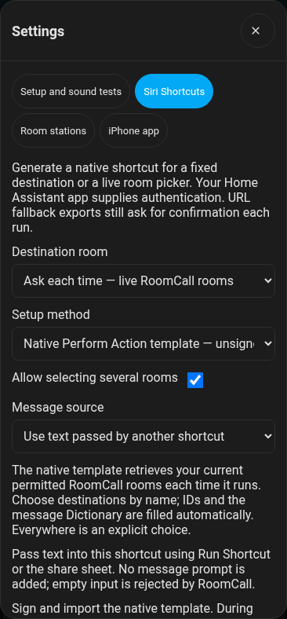

# Siri and room announcements

Use **“Hey Siri, run RoomCall Basement”** to dictate a message to your basement
speakers. RoomCall uses the configured HA speech provider (for example Piper),
with the configured chime before speech. HomePods are not required.

Avoid naming the shortcut **Intercom**: Siri may interpret that as Apple's
HomePod Intercom command instead of running RoomCall.

## Recommended: Home Assistant Perform Action

Open the RoomCall card's **Settings → Siri Shortcuts**, choose your destination,
and select **Native Perform Action template — unsigned, sign on a Mac**. The panel also
shows manual setup instructions; follow those without downloading/signing a file.
The instructions use
the exact room ID from your installation.



On your iPhone:

1. Open **Shortcuts → +** and add **Ask for Input**, with input type **Text** and
   a prompt such as “What should I announce in Basement?” Siri speaks this prompt;
   opening the shortcut manually gives you a text field.
2. Add **Dictionary**, with two entries:

    | Key | Type | Value |
    |---|---|---|
    | `areas` | Text | `basement` (use the ID shown by RoomCall) |
    | `message` | Text | Select the **Ask for Input** magic variable. |

    RoomCall accepts a single room ID as well as a list. A Dictionary correctly
    handles quotes, emoji and newlines in the message.
3. Add **Home Assistant → Perform Action** (*Call Service* in older app versions).
   Select your **Server**, choose **`roomcall.broadcast`**, and set **Action data**
   to the **Dictionary** variable. Do not type the variable's name as literal text.
4. Name the shortcut **RoomCall Basement**. Run it once to grant any requested
   iOS permissions, then say **“Hey Siri, run RoomCall Basement.”**

This follows the [Companion app's supported App Intent setup](https://companion.home-assistant.io/docs/integrations/siri-shortcuts/).
It avoids the URL handler's confirmation on every call. iOS can still require
permissions, unlocking, or phone interaction depending on the device and context.
The server is selected on your phone; RoomCall cannot infer the Companion app's
private server identifier from HA.

To upgrade a URL shortcut, keep **Ask for Input**, remove **URL Encode / Open URL**,
and add **Dictionary → Perform Action** as above. Do not use Apple's Home
**Intercom** action.

## One shortcut with a live room picker

In **RoomCall → Settings → Siri Shortcuts**, choose **Ask each time — live RoomCall rooms**.
Leave a **Native Perform Action** method selected, optionally enable **Allow selecting
several rooms**, and choose the message source:

- **Ask for text or Siri dictation** asks for a message on each run.
- **Use text passed by another shortcut** takes the Shortcut Input. Pass text with
  **Run Shortcut**; an empty input produces an error instead of an announcement.

Generate the template, sign it ([how](#downloadable-shortcut-generator)), then import it. On import, choose your HA server and
**roomcall.communicate** for **both** Home Assistant steps. Fixed-room templates
have one Home Assistant step: choose your server and **roomcall.broadcast**.
These selectors belong to the Companion app and must be configured on the phone;
the generated file contains no user's server ID, address, credentials or dictated message.
The template already builds the Dictionary and passes its variables correctly.

The live template uses **Perform Action** with
`{"operation":"discover","request":{}}`, reads **shortcut_choices**, and presents
its friendly names with **Choose from List**. It sends the selected area IDs and
message through the structured `send` operation. Only permitted destinations are
listed. Duplicate names are disambiguated by area ID. New RoomCall rooms appear
on the next run. **Everywhere** is an explicit choice; an empty selection never
silently becomes Everywhere. Canceling the picker cancels the shortcut.

Use a current Companion app that supports responses from **Perform Action**.
The two native steps must select the same server. This uses the app's existing
connection and authentication; it does not require an HA token in Shortcuts.

## Downloadable shortcut generator

!!! warning "\"Shortcut could not be imported\""
    iPhones only import `.shortcut` files signed by Apple, and only a Mac can sign one
    locally. Files labelled **unsigned** must be signed on a Mac first (below). Without a
    Mac, either build the shortcut by hand with [Perform Action](#recommended-home-assistant-perform-action)
    (about two minutes, fixed room) or use a **Signed … HubSign account** option with your
    own HubSign key, which imports straight on the iPhone, live room picker included.

Apple requires generated `.shortcut` files to be signed before importing on iPhone.
The generator offers:

| Format | What you do next |
|---|---|
| **Native Perform Action template — unsigned, sign on a Mac** | Sign on a Mac first, then import and configure its HA selectors. Supports the live picker and Shortcut Input. |
| **Signed native Perform Action** | Supply your own HubSign API key and signing consent. Configure its HA selectors during import. |
| **Cherri source** | Fixed-room URL fallback; compile/sign with Cherri. |
| **Unsigned shortcut** | Fixed-room URL fallback; sign locally on a Mac. |
| **Signed iPhone shortcut** | Fixed-room URL fallback; supply your own HubSign key and consent. |

For local signing on a Mac:

```bash
shortcuts sign --mode anyone --input "RoomCall Basement unsigned.shortcut" --output "RoomCall Basement.shortcut"
```

For portable Cherri source:

```bash
cherri "RoomCall Basement.cherri" --hubsign --share=anyone
```

URL fallback exports use the first server configured in the HA app, open the app,
and require confirmation every run. Native templates use **Perform Action** to
avoid that repeated URL confirmation. iOS may still require permissions or unlocking.

Optional signing sends the generated shortcut and its destination name/ID to
RoutineHub, along with your own HubSign API key for that request. RoomCall never
stores the key; the password field clears after the request or on closing Settings.
No HA address, token or spoken message is sent. Source exports need no external
request. Unsigned files cannot be imported directly on iPhone.

## Chimes and latency

RoomCall prepares one audio file containing the configured chime followed by the
speech, then sends that same clip to the selected speakers. Chime TTS is not
required for RoomCall announcements. Turning the chime off retains HA's direct
TTS media route. Invalid speech/chime preparation returns an error and sends no
partial announcement.

Delay includes Siri dictation, HA connection, speech synthesis, audio preparation,
and the speaker's startup time. The URL route adds an app switch and confirmation.
`communicate` → `diagnose` includes the local `tts_prepare` timing; delivery evidence
separates request acceptance, hosted audio fetches and matching playback reports.
None of these proves that a person heard the announcement.

## Urgent calls and people

Add `priority` → Text → `urgent` to the Dictionary for urgent calls. These bypass
RoomCall Do Not Disturb and quiet hours and use the configured urgent volume.

To follow a person, replace `areas` with `people` → Text → `person.alex`. This
requires room presence such as [Bermuda](https://github.com/agittins/bermuda), or
an explicitly configured fallback room.

## Android

Use the Home Assistant app's **Assist** or a Tasker / Google Assistant routine
that performs `roomcall.broadcast` with the same data.
